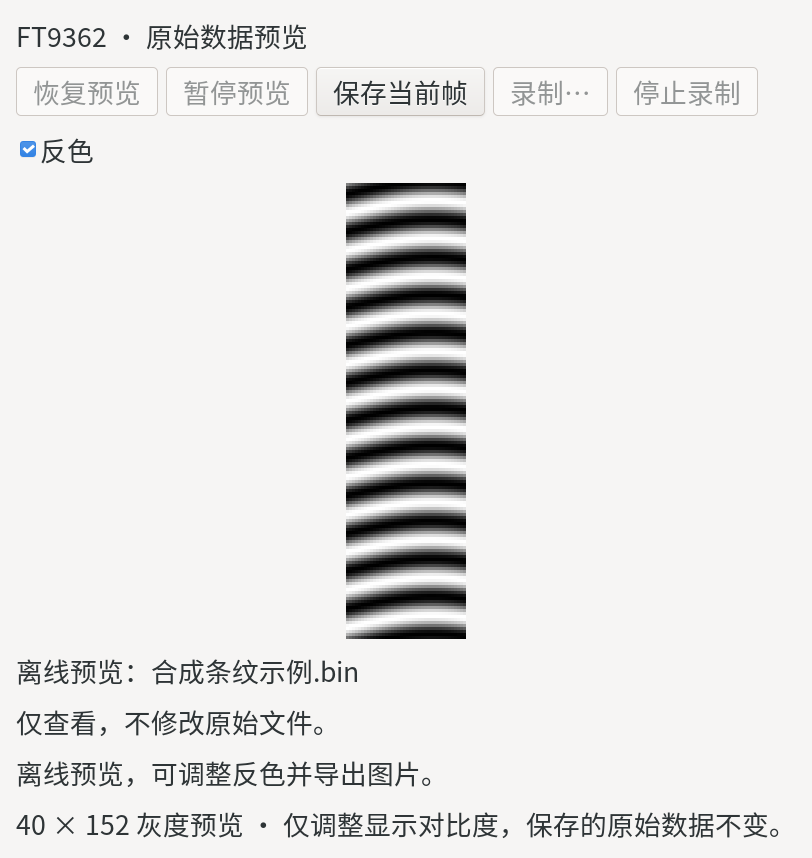

# FT9362 Driver and Capture Tools

English | [简体中文](README.cn.md)

A Linux development project for the FocalTech FT9362 (USB `2808:0752`), with a libfprint driver, an independent C++ algorithm library (`libfocaltech.0752.algo.so`) linked by libfprint, Python capture tools, and protocol research documentation.

**Fingerprint authentication is under active development. The current version supports capture and development only and must not be used for authentication.** The C++ backend is a placeholder: enrollment stores the complete raw frame, verification reports a match after successful capture, and identification selects the first entry in a nonempty gallery. Feature extraction and actual fingerprint matching are not yet implemented.

## Quick Start

On Linux, install Nix with flakes enabled, then run from the repository root:

```sh
nix develop
python tools/capture.py
```

The GUI starts a live preview without saving automatically. It supports pausing, recording by finger, appending recording sessions, exporting the current frame, and device diagnostics. Comprehensive protocol validation runs all stages automatically with guided finger actions. The same entry point provides terminal capture and offline preview:

```sh
python tools/capture.py --cli --count 3 --timeout 30
python tools/capture.py --preview /path/to/frame.bin
```

Output defaults to `build/captures/`, which Git ignores. The development environment does not install host udev rules or replace the system libfprint. See the [usage guide](docs/usage.md) for device permissions.

## Screenshot



Offline preview with synthetic stripes; no real fingerprint data is shown.

## Project Structure

| Path | Contents |
| --- | --- |
| [driver/](driver/) | libfprint C driver and an independent C++ algorithm backend without third-party libraries |
| [tools/](tools/) | Shared GUI / CLI entry point and internal modules |
| [tests/](tests/) | Driver, C ABI, and Python regression tests |
| [docs/](docs/) | Usage, development, protocol, and Windows porting documentation |
| [attachments/](attachments/) | Original Windows driver samples, provenance, and checksums |
| [flake.nix](flake.nix), [flake.lock](flake.lock) | Build definition and pinned dependencies |

## Documentation and Development

The detailed guides are currently in Chinese:

- [Usage guide](docs/usage.md): running the tools, recording, exporting, and troubleshooting.
- [Development guide](docs/development.md): builds, tests, the state machine, memory ownership, and the C++ interface contract.
- [Imaging study](docs/imaging-characteristics.md): measured intensity, texture scale, partial coverage, and refresh behavior, illustrated with synthetic images containing no real fingerprints.
- [Algorithm design](docs/matching-design.md): a sensor-specific design covering finger variability, bounded rotation tolerance, local CNN and attention models, multiview enrollment, and production acceptance requirements for Pocket 4.
- [Protocol and data format](docs/protocol.md): commands, raw frames, sample evidence, and unresolved questions.
- [Device capabilities](docs/device-capability.md): hardware observations, evidence scope, and unverified capabilities.
- [Windows porting reference](docs/windows-reference.md): behavior differences, commands, and evidence checked against device models and runtime branches.

```sh
nix build
nix develop -c python -m unittest discover -s tests -p 'test_*.py'
```

The build includes C/C++ tests. The Python command discovers all Python tests without accessing the sensor. GUI tests require a desktop display and are skipped when none is available. Hardware validation steps are documented in the [development guide](docs/development.md).

## Acknowledgments and License

This project is based on **Ivan Kovalev**'s [ft9362-driver](https://github.com/shokerplz/ft9362-driver). Thanks to the original author for the driver implementation and exploratory work, and to the [libfprint](https://gitlab.freedesktop.org/libfprint/libfprint) project for its framework.

This branch provides the raw capture state machine, independent C++ interface, GUI / CLI capture and recording tools, device diagnostics, and regression tests. Protocol research documents the evidence and validation limits. The development behavior in this branch does not represent the original author's upstream implementation.

The code remains licensed under **LGPL-2.1-or-later**, with the original copyright notices preserved. See [LICENSE](LICENSE) for the full terms. Redistributed modifications must retain the applicable copyright, license, and modification notices; binary distribution also requires providing corresponding source and meeting the other applicable license obligations. The software is provided without warranty as stated in the license.

The [Windows driver attachments](attachments/README.md) are original vendor samples retained for analysis. Their rights belong to their respective owners; the project's LGPL notice does not apply to them, and this repository grants no permission to redistribute them.
