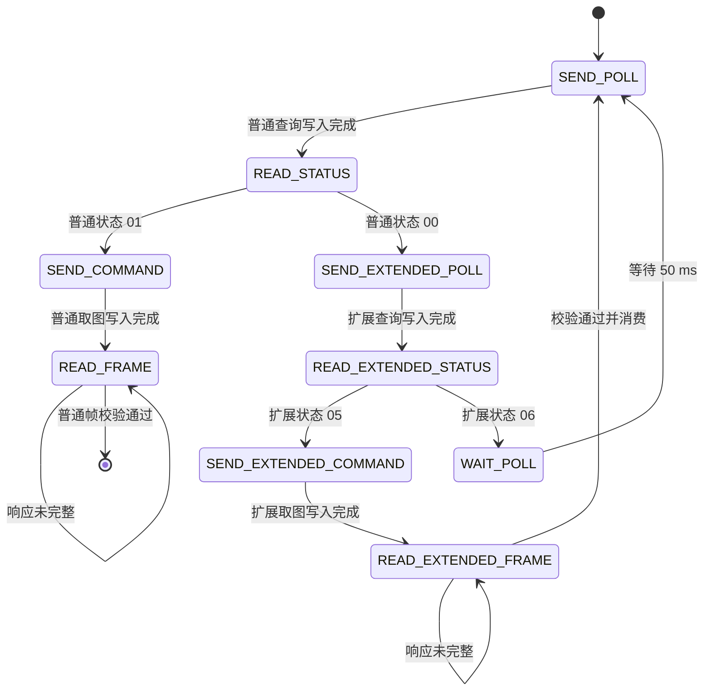

# 开发指南

## 构建与测试

[flake.nix](../flake.nix) 在锁定的 libfprint 上加入驱动，注册 USB ID，并接入 C/C++ 回归测试。算法入口为 [entry.h](../driver/algorithm/entry.h) / [entry.cpp](../driver/algorithm/entry.cpp)，由独立的 [Meson 目标](../driver/algorithm/meson.build)生成 `libfocaltech.0752.algo.so`，通过 C ABI 动态链接到 libfprint。算法源码不再直接编译进 libfprint 或测试程序。

构建产物包含 `lib/libfprint-2.so`、`lib/libfocaltech.0752.algo.so`、类型库和 udev 规则，不包含系统 fprintd 配置。算法库没有 GLib 或 libfprint 依赖；驱动测试与独立 C ABI 测试均链接同一个算法共享库。

```sh
nix build
nix develop
python tests/test_capture_tools.py
python tests/test_capture_gui.py
```

Nix 构建执行 libfprint 构建检查以及本工程的 C/C++ 测试。GUI 测试使用模拟设备，需要显示服务；没有显示时会跳过，不能将跳过计为通过。

| 测试 | 覆盖范围 |
| --- | --- |
| [test-focaltech-raw.c](../tests/test-focaltech-raw.c) | USB 回调、分块重组、状态流转、取消、异常和 libfprint 动作完成 |
| [test-ft9362-algorithm.c](../tests/test-ft9362-algorithm.c) | 由 C 调用独立 C++ ABI，验证输入、占位行为和释放约定 |
| [test_capture_tools.py](../tests/test_capture_tools.py) | 数据解码、导出权限、入口路径和 SQLite 会话 |
| [test_capture_gui.py](../tests/test_capture_gui.py) | 预览、录制边界、PNG 导出、离线模式、冷却重试及设备测试入口 |
| [test_device_validation.py](../tests/test_device_validation.py) | 异步取消竞争、回调生命周期、恢复隔离、残留校验、报告脱敏及整轮自动执行；不访问硬件 |

修改 Git 工作树时，Nix 的 Git 输入只收集已纳入 Git 的文件；新源码或改名文件需先纳入版本控制。临时使用 `nix build path:.` 可包含未跟踪文件，但也会包含 Git 忽略的文件，使用前须确保源目录没有采集数据。不要为了构建提交原始指纹数据。

## 代码职责

```text
Python GUI / CLI
  → libfprint FpDevice 接口
  → C 驱动：USB、采集状态机、取消、FpPrint 适配
  → C ABI：完整帧与模板视图
  → libfocaltech.0752.algo.so：录入、1:1 认证、1:N 识别
```

| 模块 | 职责 |
| --- | --- |
| [focaltech-0752.c](../driver/focaltech-0752.c) | 注册设备、管理动作与 USB 生命周期、封装后端输出 |
| [entry.h](../driver/algorithm/entry.h) | 仅依赖标准 C 类型的接口和数据结构 |
| [entry.cpp](../driver/algorithm/entry.cpp) | 可替换的 C++ 后端，当前复制原始帧并旁路匹配 |
| [meson.build](../driver/algorithm/meson.build) | 算法共享库的构建、链接依赖与安装定义 |
| [capture.py](../tools/capture.py) | 唯一公开入口、参数和 CLI；仅 GUI 模式加载 GTK |
| [gui.py](../tools/gui.py) | 异步预览、采集控制、录制操作和图片导出 |
| [frame.py](../tools/frame.py) | 原始帧提取、文件保存与显示解码，无 GI 依赖 |
| [recording.py](../tools/recording.py) | SQLite 持久化与录制会话，无 GI 依赖 |
| [device_validation.py](../tools/device_validation.py) | 综合协议验证子进程、真实 libusb 取消及独立恢复实验，复用既有测试会话与报告 |

工具入口与界面依赖共用数据模块，数据模块不反向导入入口。新工具能力通过现有 GUI / CLI 提供，避免增加重复入口。

## 驱动生命周期

驱动是 libfprint 的用户态 GObject 子类，没有独立 `main()`。类初始化注册 `open`、`close`、`enroll`、`verify`、`identify` 和 `cancel` 回调；三种采集动作共用同一状态机，收到完整帧后按当前动作调用后端。

打开设备只 claim USB 接口 0，关闭时清理帧缓存并 release 接口。它们将 GUsb 错误交给 libfprint 完成接口；目前没有设备专用初始化、休眠、唤醒或端口恢复命令。

采集使用 libfprint 已有的 `FpiSsm`：



四个读取状态共用响应接收器，状态包也允许分块。传输错误、短写、协议错误或取消结束状态机；只有正常完成普通帧才调用后端。通用协议校验接受零或一个包外字节；普通帧在交付前另行检查 12,166 字节保存契约，扩展帧不受该契约约束。扩展图像用于推进固件刷新，完整消费后丢弃，不替代普通图像。此流程来自[实机通道对照](device-capability.md)，新驱动的连续采集和时序仍需实机验收。

必须保持以下不变量：

- 每个动作最多一个状态机、一个待完成 USB 传输；主循环串行推进。
- 只按 `actual_length` 累计数据，请求容量按 64 字节对齐；不把分配容量当作有效数据，不截断超量响应。
- 普通与扩展响应均验证起始标记、长度、BCC、设备状态、预期数据长度及包外字节数；校验完成前不交付后端。格式见[协议文档](protocol.md)。
- 每条 OUT 最多 1 秒；OUT 成功后开始单条响应总预算，状态 1 秒、图像 5 秒。`reply_deadline_us` 保存单调时钟上的截止时间（微秒），后续分块仅使用剩余时间，不受系统校时影响；它不是等待手指的总时限。
- 每次提交使用 libfprint 当前动作的 cancellable。存在待完成传输时，取消先等待 USB 回调，避免提前释放状态机。
- USB 回调先清除 `transfer_pending`，再检查动作取消；取消优先于普通传输错误。仅有轮询延时时，取消撤销延时并结束状态机。
- 普通 00 是未就绪，不保证手指离开；扩展读完后必须重新查询普通状态。不能据此实现录入时的抬手计数。
- 错误所有权交给对应完成接口后不再使用；一个动作只完成一次。成功或失败均清理主机缓存并复位上报状态。

取消 USB 请求并不等于撤销设备命令。传输中途取消或错误可能留下完整或部分应答，后续动作会验证实际读到的数据，但没有序列号可证明所有合法应答都属于本次请求。当前没有硬件 STOP、自动排空或设备重同步，不能承诺此时再次开始即可恢复。等待轮询期间取消与传输中取消必须分别验收；不要通过模拟器清空队列来掩盖后者。

缓冲区清零用于清理驱动状态，不代表 GLib、序列化对象、文件或系统内存中的其他副本也已擦除。

## C++ 接口契约

后端仅使用 C/C++ 标准库及系统基础运行环境，不引入第三方库，包括仅头文件或静态嵌入的库。它不接收任何 GLib、GObject、GUsb 或 libfprint 对象；图像处理、匹配和必要的模型前向计算自行实现，算法方案见[算法设计](matching-design.md)。离线训练工具不得成为算法库的构建或运行依赖。C 适配层负责系统接口，后端负责数据处理；无需在 C++ 中重复构造 libfprint 状态机。

算法通过共享库导出四个 C 接口，函数名和数据结构保持不变。新增内部实现文件时加入算法的 Meson 目标。动态链接采用常规共享库依赖，部署时须同时提供 libfprint 与算法库；Nix 构建负责设置安装后的库查找路径，无需手动设置 `LD_LIBRARY_PATH`。Nix store 产物不可原地替换，更新算法后重新构建即可。

| 接口 | 当前行为 | 真正实现的职责 |
| --- | --- | --- |
| `ft9362_enroll` | 复制完整帧为 `FT9362-RAW-v1` 模板 | 预处理、质量判断、特征提取和模板序列化 |
| `ft9362_verify` | 忽略参考内容，成功采集后 `matched=1` | 解析参考模板，执行 1:1 匹配 |
| `ft9362_identify` | 非空图库返回索引 0；空图库返回 `FT9362_NO_MATCH` | 执行 1:N 匹配，返回原图库索引 |
| `ft9362_template_free` | 释放输出字节并将结构清零 | 与后端分配方式配套释放所有输出资源 |

### 输入与所有权

`Ft9362Frame` 是包含协议头尾的完整 USB 帧。`Ft9362TemplateView` 含格式字符串、只读字节和长度。所有输入只在同步调用期间借用，后端不得保存指针或在返回后访问。

C 适配层持有输入 GVariant，直到后端调用结束。不存在或不符合 `(say)` 的模板转换为全零视图，识别图库中仍保留原位置；后端应验证格式、版本与长度，不兼容时返回 `FT9362_STATUS_INVALID_TEMPLATE`。

输出 `Ft9362Template` 的格式标签须为有效、NUL 结尾的 UTF-8 字符串；数据长度由后端决定。输出资源在 `ft9362_template_free` 前有效，调用方只能通过该接口释放，不能单独释放字段。当前格式标签为静态字符串，字节使用 `malloc` 分配。

调用方传入空输出结构，复用前先释放旧结果。失败时输出也必须保持可释放状态。C++ 异常必须在 ABI 内转换为状态码，不得跨越 C/GLib 调用栈。

### 返回值与持久化

录入成功必须返回非空模板。认证、识别的 `scanned` 可全零，表示不附带本次扫描模板；当前 C++ 后端仍返回完整原始帧。非空输出必须同时具有有效格式标签、数据和非零长度。

libfprint 1.94.100 对匹配成功时附带的 RAW 扫描模板增加了一致性检查。C 适配层仅在扫描模板与匹配的参考模板相等时附带它，否则传 `NULL`；未匹配时仍可返回扫描模板。匹配结论仍由后端决定，这项检查不执行指纹相似度匹配，也不影响录入接口和 Python 原始帧采集。

`FT9362_STATUS_OK` 只代表处理成功，是否匹配由 `matched` 或 `matched_index` 表达。`FT9362_NO_MATCH` 为 `SIZE_MAX`；其他索引须在原图库范围内。非法模板映射为 `FP_DEVICE_ERROR_DATA_INVALID`，未实现映射为 `FP_DEVICE_ERROR_NOT_SUPPORTED`，其他失败映射为一般设备错误。

适配层将后端数据复制到 FpPrint 的 `fpi-data`，类型为 `(say)`，即格式字符串与字节数组。`FPI_PRINT_RAW` 表示 libfprint 私有数据类别，不要求内容永远是原始图像；`device_stored=FALSE` 表示模板不存于传感器。

未来特征模板须使用新的格式标签，明确版本兼容。当前采集工具只接受 `FT9362-RAW-v1` 与 12,166 字节；替换真实模板后应提供明确的开发采集通路，不能把特征数据继续当作图像解码。

当前 ABI 是单帧同步处理，没有多次录入会话、异步任务或独立取消接口。执行方式依据实测耗时与主循环预算决定；耗时处理需要另行设计异步执行、输入副本和回调生命周期，不能直接阻塞主循环，也不能仅靠增加 cancellable 指针解决。

## 验证与扩展

硬件变更除自动测试外，应验证：首次打开采集、连续采集、抬指重放、等待手指时取消、传输中取消、关闭重开，以及拔插后的错误恢复。若涉及电源，还需验证冷启动、挂起/恢复。自动测试不能证明固件状态或设备时序正确。

协议工作先参考[Windows 移植参考](windows-reference.md)，核对目标 PID、运行时分支和证据来源，再扩展初始化与恢复；保持已实现的状态、长度和 BCC 校验。不要将其他控制器的固件或 C652 专用服务行为用于 FT9362。

C 模拟器使用带正确头部、长度和 BCC 的合成图像，普通与扩展载荷刻意不同。OUT 生成响应并入队，IN 消费队首；取消或错误不清空设备队列。覆盖整帧/分块读取、拆分头部、连续接触刷新、扩展读取后仍未就绪、扩展响应无包外字节、损坏响应、设备拒绝、总截止时间、取消与残留响应拒绝。后端输出按字节比对普通帧，确保扩展数据和尾字节不会混入像素或被替换。

这些测试验证软件边界，不证明设备真实队列行为，也不覆盖所有可能合法的陈旧应答。新固件返回格式、帧间时序和取消恢复需另行实测；不得把模拟器中的恢复结果推广为硬件保证。

显示变换集中于 [frame.py](../tools/frame.py)，始终保存未经显示处理的原始数据。算法评估应按独立采集会话划分数据，避免把相邻帧作为相互独立的验证样本。

C/C++ 格式遵循 [driver/.clang-format](../driver/.clang-format)。改动应同时更新相关测试和对应文档；新增抽象须服务于真实的状态、所有权或业务边界。

综合协议验证通过现有设备测试下拉列表运行，计划与证据边界见[设备能力记录第 13 节](device-capability.md#13-综合协议验证入口)。取消矩阵直接使用 libusb，不声称命中了 libfprint 内部的某个状态；生产驱动的中途取消恢复仍需依据实机报告决策。异步传输的缓冲与回调保留到完成回调后再释放，外层子进程看门狗负责处理后端失去响应。不要把 USB 超时冒充取消命中。
