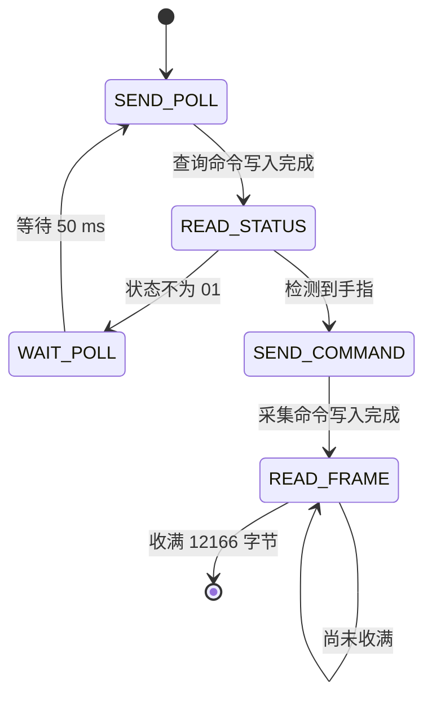

# 开发指南

## 构建与测试

[flake.nix](../flake.nix) 在锁定的 libfprint 上加入驱动，注册 USB ID，并接入 C/C++ 回归测试。算法入口为 [entry.h](../driver/algorithm/entry.h) / [entry.cpp](../driver/algorithm/entry.cpp)，由独立的 [Meson 目标](../driver/algorithm/meson.build)生成 `libfocaltech.0752.algo.so`，通过 C ABI 动态链接到 libfprint。算法源码不再直接编译进 libfprint 或测试程序。

构建产物包含 `lib/libfprint-2.so`、`lib/libfocaltech.0752.algo.so`、类型库和 udev 规则，不包含系统 fprintd 配置。算法库没有 GLib 或 libfprint 依赖；驱动测试与独立 C ABI 测试均链接同一个算法共享库。

```sh
nix build
nix develop
python tests/test_capture_tools.py
python tests/test_capture_gui.py
```

Nix 构建执行 libfprint 构建检查以及本工程的 C/C++ 测试。GUI 测试使用模拟设备，需要显示服务；没有显示时会跳过，不能将跳过计为通过。

| 测试 | 覆盖范围 |
| --- | --- |
| [test-focaltech-raw.c](../tests/test-focaltech-raw.c) | USB 回调、分块重组、状态流转、取消、异常和 libfprint 动作完成 |
| [test-ft9362-algorithm.c](../tests/test-ft9362-algorithm.c) | 由 C 调用独立 C++ ABI，验证输入、占位行为和释放约定 |
| [test_capture_tools.py](../tests/test_capture_tools.py) | 数据解码、导出权限、入口路径和 SQLite 会话 |
| [test_capture_gui.py](../tests/test_capture_gui.py) | 预览、录制边界、PNG 导出、离线模式及冷却重试 |

修改 Git 工作树时，Nix 的 Git 输入只收集已纳入 Git 的文件；新源码或改名文件需先纳入版本控制。临时使用 `nix build path:.` 可包含未跟踪文件，但也会包含 Git 忽略的文件，使用前须确保源目录没有采集数据。不要为了构建提交原始指纹数据。

## 代码职责

```text
Python GUI / CLI
  → libfprint FpDevice 接口
  → C 驱动：USB、采集状态机、取消、FpPrint 适配
  → C ABI：完整帧与模板视图
  → libfocaltech.0752.algo.so：录入、1:1 认证、1:N 识别
```

| 模块 | 职责 |
| --- | --- |
| [focaltech-0752.c](../driver/focaltech-0752.c) | 注册设备、管理动作与 USB 生命周期、封装后端输出 |
| [entry.h](../driver/algorithm/entry.h) | 仅依赖标准 C 类型的接口和数据结构 |
| [entry.cpp](../driver/algorithm/entry.cpp) | 可替换的 C++ 后端，当前复制原始帧并旁路匹配 |
| [meson.build](../driver/algorithm/meson.build) | 算法共享库的构建、链接依赖与安装定义 |
| [capture.py](../tools/capture.py) | 唯一公开入口、参数和 CLI；仅 GUI 模式加载 GTK |
| [gui.py](../tools/gui.py) | 异步预览、采集控制、录制操作和图片导出 |
| [frame.py](../tools/frame.py) | 原始帧提取、文件保存与显示解码，无 GI 依赖 |
| [recording.py](../tools/recording.py) | SQLite 持久化与录制会话，无 GI 依赖 |

工具入口与界面依赖共用数据模块，数据模块不反向导入入口。新工具能力通过现有 GUI / CLI 提供，避免增加重复入口。

## 驱动生命周期

驱动是 libfprint 的用户态 GObject 子类，没有独立 `main()`。类初始化注册 `open`、`close`、`enroll`、`verify`、`identify` 和 `cancel` 回调；三种采集动作共用同一状态机，收到完整帧后按当前动作调用后端。

打开设备只 claim USB 接口 0，关闭时清理帧缓存并 release 接口。它们将 GUsb 错误交给 libfprint 完成接口；目前没有设备专用初始化、休眠、唤醒或端口恢复命令。

采集使用 libfprint 已有的 `FpiSsm`：



USB 错误、短写、无效状态响应、空帧片段、越界片段或取消均结束状态机。状态机成功后才调用后端；无论成功或失败，动作完成前都清理缓存并复位手指状态。

必须保持以下不变量：

- 每个动作最多一个状态机、一个待完成 USB 传输；主循环串行推进。
- 只按 `actual_length` 累计数据，不把分配容量当作有效数据，也不截断超量响应。
- 当前每次帧读取申请 12,166 字节；响应不得超过剩余空间。恰好收满后完成，无图像头或 XOR 校验。
- 每次提交使用 libfprint 当前动作的 cancellable。存在待完成传输时，取消先等待 USB 回调，避免提前释放状态机。
- USB 回调先清除 `transfer_pending`，再检查动作取消；取消优先于普通传输错误。仅有轮询延时时，取消先撤销延时再结束状态机。
- 错误所有权交给对应完成接口后不再使用；一个动作只完成一次。

缓冲区清零用于清理驱动状态，不代表 GLib、序列化对象、文件或系统内存中的其他副本也已擦除。

## C++ 接口契约

后端不接收任何 GLib、GObject、GUsb 或 libfprint 对象。C 适配层负责系统接口，后端负责数据处理；无需在 C++ 中重复构造 libfprint 状态机。

算法通过共享库导出四个 C 接口，函数名和数据结构保持不变。新增内部实现文件时加入算法的 Meson 目标。动态链接采用常规共享库依赖，部署时须同时提供 libfprint 与算法库；Nix 构建负责设置安装后的库查找路径，无需手动设置 `LD_LIBRARY_PATH`。Nix store 产物不可原地替换，更新算法后重新构建即可。

| 接口 | 当前行为 | 真正实现的职责 |
| --- | --- | --- |
| `ft9362_enroll` | 复制完整帧为 `FT9362-RAW-v1` 模板 | 预处理、质量判断、特征提取和模板序列化 |
| `ft9362_verify` | 忽略参考内容，成功采集后 `matched=1` | 解析参考模板，执行 1:1 匹配 |
| `ft9362_identify` | 非空图库返回索引 0；空图库返回 `FT9362_NO_MATCH` | 执行 1:N 匹配，返回原图库索引 |
| `ft9362_template_free` | 释放输出字节并将结构清零 | 与后端分配方式配套释放所有输出资源 |

### 输入与所有权

`Ft9362Frame` 是包含协议头尾的完整 USB 帧。`Ft9362TemplateView` 含格式字符串、只读字节和长度。所有输入只在同步调用期间借用，后端不得保存指针或在返回后访问。

C 适配层持有输入 GVariant，直到后端调用结束。不存在或不符合 `(say)` 的模板转换为全零视图，识别图库中仍保留原位置；后端应验证格式、版本与长度，不兼容时返回 `FT9362_STATUS_INVALID_TEMPLATE`。

输出 `Ft9362Template` 的格式标签须为有效、NUL 结尾的 UTF-8 字符串；数据长度由后端决定。输出资源在 `ft9362_template_free` 前有效，调用方只能通过该接口释放，不能单独释放字段。当前格式标签为静态字符串，字节使用 `malloc` 分配。

调用方传入空输出结构，复用前先释放旧结果。失败时输出也必须保持可释放状态。C++ 异常必须在 ABI 内转换为状态码，不得跨越 C/GLib 调用栈。

### 返回值与持久化

录入成功必须返回非空模板。认证、识别的 `scanned` 可全零，表示不附带本次扫描模板；当前实现仍返回完整原始帧。非空输出必须同时具有有效格式标签、数据和非零长度。

`FT9362_STATUS_OK` 只代表处理成功，是否匹配由 `matched` 或 `matched_index` 表达。`FT9362_NO_MATCH` 为 `SIZE_MAX`；其他索引须在原图库范围内。非法模板映射为 `FP_DEVICE_ERROR_DATA_INVALID`，未实现映射为 `FP_DEVICE_ERROR_NOT_SUPPORTED`，其他失败映射为一般设备错误。

适配层将后端数据复制到 FpPrint 的 `fpi-data`，类型为 `(say)`，即格式字符串与字节数组。`FPI_PRINT_RAW` 表示 libfprint 私有数据类别，不要求内容永远是原始图像；`device_stored=FALSE` 表示模板不存于传感器。

未来特征模板须使用新的格式标签，明确版本兼容。当前采集工具只接受 `FT9362-RAW-v1` 与 12,166 字节；替换真实模板后应提供明确的开发采集通路，不能把特征数据继续当作图像解码。

当前 ABI 是单帧同步处理，没有多次录入会话、异步任务或独立取消接口。耗时算法需要另行设计工作线程、输入副本和回调生命周期；不能直接阻塞主循环，也不能仅靠增加 cancellable 指针解决。

## 验证与扩展

硬件变更除自动测试外，应验证：首次打开采集、连续采集、抬指重放、等待手指时取消、传输中取消、关闭重开，以及拔插后的错误恢复。若涉及电源，还需验证冷启动、挂起/恢复。自动测试不能证明固件状态或设备时序正确。

协议工作先参考[Windows 移植参考](windows-reference.md)，核对目标 PID、运行时分支和证据来源，再实现初始化、状态解析、长度与 XOR 检查。不要将其他控制器的固件或 C652 专用服务行为用于 FT9362。

现有 C 测试包含用于验证字节保留的合成帧，并不全部是校验正确的设备协议包。新增协议校验时，应补充合法帧、损坏帧及传输边界案例，不应简单删除失败测试。

显示变换集中于 [frame.py](../tools/frame.py)，始终保存未经显示处理的原始数据。算法评估应按独立采集会话划分数据，避免把相邻帧作为相互独立的验证样本。

C/C++ 格式遵循 [driver/.clang-format](../driver/.clang-format)。改动应同时更新相关测试和对应文档；新增抽象须服务于真实的状态、所有权或业务边界。
