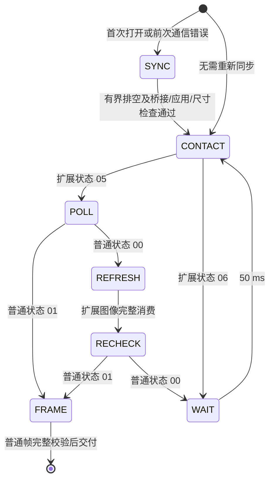

# 开发指南

## 构建与测试

[flake.nix](../flake.nix) 在锁定的 libfprint 上加入驱动，注册 USB ID，并接入 C/C++ 回归测试。算法入口为 [entry.h](../driver/algorithm/entry.h) / [entry.cpp](../driver/algorithm/entry.cpp)，由独立的 [Meson 目标](../driver/algorithm/meson.build)生成 `libfocaltech.0752.algo.so`，通过 C ABI 动态链接到 libfprint。算法源码由共享库目标编译，libfprint 与测试程序链接该库。

构建产物包含 `lib/libfprint-2.so`、`lib/libfocaltech.0752.algo.so`、类型库和 udev 规则，不包含系统 fprintd 配置。算法库没有 GLib 或 libfprint 依赖；驱动测试与独立 C ABI 测试均链接同一个算法共享库。

```sh
nix build
nix develop -c python -m unittest discover -s tests -p 'test_*.py'
```

Nix 构建执行 libfprint 构建检查以及本工程的 C/C++ 测试。GUI 测试使用模拟设备，需要显示服务；没有显示时会跳过，不能将跳过计为通过。

| 测试 | 覆盖范围 |
| --- | --- |
| [test-focaltech-raw.c](../tests/test-focaltech-raw.c) | USB 回调、分块重组、状态流转、取消、异常和 libfprint 动作完成 |
| [test-ft9362-algorithm.c](../tests/test-ft9362-algorithm.c) | 由 C 调用独立 C++ ABI，验证输入、占位行为和释放约定 |
| [test_capture_tools.py](../tests/test_capture_tools.py) | 数据解码、导出权限、入口路径和 SQLite 会话 |
| [test_capture_gui.py](../tests/test_capture_gui.py) | 预览、录制边界、PNG 导出、离线模式、冷却重试及设备测试入口 |
| [test_probe_device.py](../tests/test_probe_device.py) | 封包、解析、长度边界及打开重试 |
| [test_device_capabilities.py](../tests/test_device_capabilities.py) | 设备实验的前置条件、异常中止及恢复 |
| [test_device_testing.py](../tests/test_device_testing.py) | 会话计划、报告、恢复与续测 |
| [test_analyze_finger_interaction.py](../tests/test_analyze_finger_interaction.py) | 响应与样本一致性、无效记录拒绝 |
| [test_device_validation.py](../tests/test_device_validation.py) | 异步取消竞争、回调生命周期、恢复隔离、残留校验、报告脱敏及整轮自动执行；不访问硬件 |

修改 Git 工作树时，Nix 的 Git 输入只收集已纳入 Git 的文件；新源码或改名文件需先纳入版本控制。临时使用 `nix build path:.` 可包含未跟踪文件，但也会包含 Git 忽略的文件，使用前须确保源目录没有采集数据。不要为了构建提交原始指纹数据。

## 代码职责

```text
预览 / 录制 / CLI 采集
  → libfprint → C 驱动（USB、状态机、FpPrint 适配）
  → C ABI → libfocaltech.0752.algo.so

GUI 设备测试
  → 测试会话 → 独占 USB 的协议实验与证据保存
  → 生命周期子进程 → libfprint
```

| 模块 | 职责 |
| --- | --- |
| [focaltech-0752.c](../driver/focaltech-0752.c) | 注册设备、管理动作与 USB 生命周期、封装后端输出 |
| [entry.h](../driver/algorithm/entry.h) | 仅依赖标准 C 类型的接口和数据结构 |
| [entry.cpp](../driver/algorithm/entry.cpp) | 可替换的 C++ 后端，当前复制原始帧并旁路匹配 |
| [meson.build](../driver/algorithm/meson.build) | 算法共享库的构建、链接依赖与安装定义 |
| [capture.py](../tools/capture.py) | 用户采集入口、参数和 CLI；仅 GUI 模式加载 GTK |
| [gui.py](../tools/gui.py) | 异步预览、采集控制、录制操作和图片导出 |
| [frame.py](../tools/frame.py) | 原始帧提取、文件保存与显示解码，无 GI 依赖 |
| [recording.py](../tools/recording.py) | SQLite 持久化与录制会话，无 GI 依赖 |
| [device_test_gui.py](../tools/device_test_gui.py) / [device_testing.py](../tools/device_testing.py) | 测试界面、会话计划、报告及恢复流程 |
| [probe_device.py](../tools/probe_device.py) / [device_capabilities.py](../tools/device_capabilities.py) | libusb 封装、协议解析及有界设备实验 |
| [device_validation.py](../tools/device_validation.py) | 综合协议验证子进程、真实 libusb 取消及独立恢复实验，复用既有测试会话与报告 |

采集入口和界面共用帧解码与录制模块。设备测试通过 GUI 启动，由测试会话串行管理 USB 所有权；底层脚本入口用于开发调试。诊断报告与采集数据分开保存。

## 驱动生命周期

驱动是 libfprint 的用户态 GObject 子类，没有独立 `main()`。类初始化注册 `open`、`close`、`enroll`、`verify`、`identify` 和 `cancel` 回调；三种采集动作共用同一状态机，收到完整帧后按当前动作调用后端。

### 状态与所有权

libfprint 提供 `FpiSsm` 状态机和 `FpiUsbTransfer` 异步 USB 传输。本文的“命令事务”是驱动对一次 OUT 与完整响应接收的组织方式，由 [focaltech-0752.c](../driver/focaltech-0752.c) 内部结构和函数实现；它不是 libfprint 的独立事务 API，也不提供原子性或回滚。

| 状态 | 生命周期 | 职责 |
| --- | --- | --- |
| `needs_sync` | 跨采集动作保存，每次打开置位 | 记录下一动作是否必须先排空和检查设备；清理主机缓存不清除此标记 |
| `Ft9362CaptureState` | 单次 enroll、verify 或 identify | 持有采集状态机及排空预算，选择下一条命令 |
| `Ft9362Transaction` | 单条命令及其响应 | 持有命令描述符、响应缓存、累计长度、截止时间和传输进行状态 |

open claim 接口 0，close release 接口。USB 拔出或重枚举由 libfprint/GUsb 的设备生命周期处理，旧对象不被驱动改绑到新 USB 地址；上层重新发现并打开的新对象从待同步状态开始。

每个动作最多一个状态机、一个待完成 USB 传输，由主循环串行推进。状态机存活至最后一个回调完成；当前动作只结束一次。错误所有权交给对应完成接口后不再使用；成功、失败和取消均清理主机缓存并复位上报状态。缓存清零不代表 GLib、序列化对象、文件或系统内存中的其他副本也已擦除。

### 采集流程与交付边界

状态机的命令节点共用发送、分块接收和校验函数；状态机只处理完整响应，不处理 USB 分片。



扩展 05/06 用于已验证范围内的采集门限，不宣称它是独立接触电平。普通 01 只表示可读帧，不能单独上报手指存在；普通 00 不能用来计算抬手次数。扩展状态 00 等未知值报协议错误，保留待同步状态，不当作接触或离开，也不无限重试。

扩展图像完整消费后丢弃，只交付普通图像。普通帧完成事务后，在交付边界检查 `FT9362-RAW-v1` 的 12,166 字节契约；格式不兼容返回 `FP_DEVICE_ERROR_NOT_SUPPORTED`，不补造尾字节、不调用后端，也不标记设备待同步。后端算法错误同样不改变已完成通信的同步状态。

### 命令接收与取消

命令描述符集中声明请求、响应数据长度、超时及健康查询预期值。协议缓冲区上限由设备响应布局定义，不依赖后端模板大小。只按 `actual_length` 累计数据，请求容量按 64 字节对齐；包括健康和状态查询在内，每条响应首次 IN 均提供 12,224 字节容量，避免用小包缓冲截断陈旧图像。

每条响应检查起始标记、长度、BCC、设备状态、预期数据长度和包外字节数；不截断、不拼接多条应答、不跳过错误响应寻找正确应答。封包与长度规则见[协议文档](protocol.md#响应边界与校验)。每条 OUT 最多 1 秒；OUT 完成后响应总预算为小包 1 秒、图像 5 秒。分块共享单调时钟截止时间，不因分片重新计时。

USB 传输不传入动作的 cancellable。用户取消只在事务边界生效：OUT 已开始就有界接收其响应，随后结束动作，不提交下一条命令、不调用后端。等待轮询时取消撤销定时器；排空时取消等当前 IN 返回后结束。

取消响应延迟包括当前事务剩余时间，最坏可覆盖尚未完成的 OUT 及其响应预算；5 秒图像超时不是整个等待手指动作的时限。超时或拔出设备时不会继续等完整帧，而是保留待同步状态后结束。

### 同步状态与恢复边界

传输错误、短写、响应损坏、健康值不符或未知采集状态将设备标记为待同步；即使同时收到用户取消，也不能丢失该标记。正常完整事务之后的取消不强制重同步；任何重新打开都重新检查。

需要同步时，下一动作先有界排空（最多 4 次、每次至多 200 ms、总预算 1 秒），再依次检查桥接 `55 AA`、应用 `A5 5A`、尺寸 `28/98` 和扩展状态 05/06。全部成立且动作未取消时才清除待同步标记；任何失败均结束当前动作，保留待同步标记。排空或健康检查失败不触发复位循环。驱动不自动重发失败命令，也不发送 USB reset、clear-halt、芯片模式写入或唤醒命令。

GUsb 的异步 Bulk finish 在超时时返回 -1，不暴露 libusb 的部分接收长度。因此排空的超时仅结束读取窗口，不记录为已证明的零字节静默；之后仍必须完成健康查询。测试模拟同样保留这个信息缺口。

排空和健康查询只能提高响应边界的可信度。协议没有事务序号，BCC 不能证明格式合法的响应属于当前请求；有界排空也不能排除更晚到达的数据。不能将一次静默或 reset 成功等同于固件恢复。实机依据和未验证项统一记录在[设备能力](device-capability.md)，模拟测试不能替代新驱动验收。

## C++ 接口契约

后端仅使用 C/C++ 标准库及系统基础运行环境，不引入第三方库，包括仅头文件或静态嵌入的库。它不接收任何 GLib、GObject、GUsb 或 libfprint 对象；图像处理、匹配和必要的模型前向计算自行实现，算法方案见[算法设计](matching-design.md)。离线训练工具不得成为算法库的构建或运行依赖。C 适配层负责系统接口，后端负责数据处理；无需在 C++ 中重复构造 libfprint 状态机。

算法共享库导出以下四个 C 接口；数据结构以 [entry.h](../driver/algorithm/entry.h) 为准。新增内部实现文件时加入算法的 Meson 目标。动态链接采用常规共享库依赖，部署时须同时提供 libfprint 与算法库；Nix 构建负责设置安装后的库查找路径，无需手动设置 `LD_LIBRARY_PATH`。Nix store 产物不可原地替换，更新算法后重新构建即可。

| 接口 | 当前行为 | 真正实现的职责 |
| --- | --- | --- |
| `ft9362_enroll` | 复制完整帧为 `FT9362-RAW-v1` 模板 | 预处理、质量判断、特征提取和模板序列化 |
| `ft9362_verify` | 忽略参考内容，成功采集后 `matched=1` | 解析参考模板，执行 1:1 匹配 |
| `ft9362_identify` | 非空图库返回索引 0；空图库返回 `FT9362_NO_MATCH` | 执行 1:N 匹配，返回原图库索引 |
| `ft9362_template_free` | 释放输出字节并将结构清零 | 与后端分配方式配套释放所有输出资源 |

### 输入与所有权

`Ft9362Frame` 是包含协议头尾的完整 USB 帧。`Ft9362TemplateView` 含格式字符串、只读字节和长度。所有输入只在同步调用期间借用，后端不得保存指针或在返回后访问。

C 适配层持有输入 GVariant，直到后端调用结束。不存在或不符合 `(say)` 的模板转换为全零视图，识别图库中仍保留原位置；后端应验证格式、版本与长度，不兼容时返回 `FT9362_STATUS_INVALID_TEMPLATE`。

输出 `Ft9362Template` 的格式标签须为有效、NUL 结尾的 UTF-8 字符串；数据长度由后端决定。输出资源在 `ft9362_template_free` 前有效，调用方只能通过该接口释放，不能单独释放字段。当前格式标签为静态字符串，字节使用 `malloc` 分配。

调用方传入空输出结构，复用前先释放旧结果。失败时输出也必须保持可释放状态。C++ 异常必须在 ABI 内转换为状态码，不得跨越 C/GLib 调用栈。

### 返回值与持久化

录入成功必须返回非空模板。认证、识别的 `scanned` 可全零，表示不附带本次扫描模板；当前 C++ 后端仍返回完整原始帧。非空输出必须同时具有有效格式标签、数据和非零长度。

libfprint 1.94.100 要求匹配成功时附带的 RAW 扫描模板与参考模板相等。C 适配层仅在扫描模板与匹配的参考模板相等时附带它，否则传 `NULL`；未匹配时仍可返回扫描模板。匹配结论仍由后端决定，这项检查不执行指纹相似度匹配，也不影响录入接口和 Python 原始帧采集。

`FT9362_STATUS_OK` 只代表处理成功，是否匹配由 `matched` 或 `matched_index` 表达。`FT9362_NO_MATCH` 为 `SIZE_MAX`；其他索引须在原图库范围内。非法模板映射为 `FP_DEVICE_ERROR_DATA_INVALID`，未实现映射为 `FP_DEVICE_ERROR_NOT_SUPPORTED`，其他失败映射为一般设备错误。

适配层将后端数据复制到 FpPrint 的 `fpi-data`，类型为 `(say)`，即格式字符串与字节数组。`FPI_PRINT_RAW` 表示 libfprint 私有数据类别，不要求内容永远是原始图像；`device_stored=FALSE` 表示模板不存于传感器。

未来特征模板须使用新的格式标签，明确版本兼容。当前采集工具只接受 `FT9362-RAW-v1` 与 12,166 字节；替换真实模板后应提供明确的开发采集通路，不能把特征数据继续当作图像解码。

当前 ABI 是单帧同步处理，没有多次录入会话、异步任务或独立取消接口。执行方式依据实测耗时与主循环预算决定；耗时处理需要另行设计异步执行、输入副本和回调生命周期，不能直接阻塞主循环，也不能仅靠增加 cancellable 指针解决。

## 验证与扩展

硬件变更除自动测试外，应验证：首次打开采集、连续采集、抬指重放、等待手指时取消、传输中取消、关闭重开，以及拔插后的错误恢复。若涉及电源，还需验证冷启动、挂起/恢复。自动测试不能证明固件状态或设备时序正确。

协议工作先参考[Windows 移植参考](windows-reference.md)，核对目标 PID、运行时分支和证据来源，再扩展初始化与恢复；保持已实现的状态、长度和 BCC 校验。不要将其他控制器的固件或 C652 专用服务行为用于 FT9362。

C 模拟器使用带正确头部、长度和 BCC 的合成图像，普通与扩展载荷刻意不同。OUT 生成响应并入队，IN 消费队首；取消或错误不清空设备队列。覆盖整帧/分块读取、拆分头部、连续接触刷新、扩展读取后仍未就绪、扩展响应无包外字节、损坏响应、设备拒绝、总截止时间、事务边界取消、残留排空及错误后重同步。后端输出按字节比对普通帧，确保扩展数据和尾字节不会混入像素或被替换。enroll、verify、identify 均覆盖格式不兼容时不调用后端、同步状态保持有效及下一动作成功；另行对照 BCC 错误必须重同步、后端错误不触发排空。

这些测试验证软件边界，不证明设备真实队列行为，也不覆盖所有可能合法的陈旧应答。新固件返回格式、帧间时序和取消恢复需另行实测；不得把模拟器中的恢复结果推广为硬件保证。

显示变换集中于 [frame.py](../tools/frame.py)，始终保存未经显示处理的原始数据。算法评估应按独立采集会话划分数据，避免把相邻帧作为相互独立的验证样本。

C/C++ 格式遵循 [driver/.clang-format](../driver/.clang-format)。改动应同时更新相关测试和对应文档；新增抽象须服务于真实的状态、所有权或业务边界。

### 综合协议验证

综合验证通过 [device_validation.py](../tools/device_validation.py) 子进程执行，使用真实 libusb 异步取消。等待手指的生命周期测试调用 libfprint；图像采样和取消矩阵直接使用 libusb，不能声称命中了 C 驱动内部某个采集状态。操作入口见[使用指南](usage.md#设备测试与报告)。

| 阶段 | 自动收集的证据 |
| --- | --- |
| 通信基线 | 复用既有 11 项无手指测试：信息、尾字节顺序、USB 状态、独占、唤醒/模式前提、固定缓冲、重开、复位和 libfprint 等待取消 |
| 通道对照 | 普通读取、附加扩展状态、附加条件扩展取图，各两轮、每轮 10 帧；固定种子打乱顺序并记录，轮前刷新普通缓冲 |
| 接触与图像 | 轻触、正常力度各 12 帧；滚动 16 帧；约 60 秒连续采集；抬手后的 3 帧；记录双通道原始值、灰度分布、邻接差异与帧间时序 |
| 取消对照 | 不提交目标命令、完整普通/扩展事务、读取首块后记录取消意图但读完普通/扩展事务，共 5 项；这些对照不调用 USB 取消 |
| 中断 × 恢复 | 9 个中断时机 × 5 种独立恢复方式，共 45 项；加上述对照合计 50 项 |
| 最终收尾 | 排空残留、复位所选设备、检查桥接/应用/尺寸、等待抬手、释放接口 |

中断时机覆盖状态命令写入/响应读取、普通命令写入/读取 1 ms/首 4096 字节后、扩展命令写入/读取 1 ms/读取 50 ms/首 4096 字节后。进行中的传输调用真实 `libusb_cancel_transfer`；首块后停止是**两次读取之间的中断**，不能冒充正在进行的 USB 请求被取消。“先读完再取消”是协议策略实验；当前 C 驱动也采用事务边界取消，但矩阵仍直接使用 libusb。

#### 基线、测量与清理

恢复方式分别为直接重新开始、有界 IN 读取残留、仅清除 IN/OUT halt、仅关闭重开、单设备 USB reset。每项基线按排空→复位→排空→桥接探测→健康查询建立；排空失败时不执行基线复位。注入故障后只使用该项指定的方法，再验证桥接/应用/尺寸及三次完整采集。测量中的 reset 不附带排空，否则不能独立评价 reset 的效果。

桥接探测每次 IN 提供 12,224 字节容量，可完整接收已知最大图像响应；最多四次读取、总预算 5 秒，要求长度、BCC、成功状态及 `55 AA` 均成立，允许至多一个包外字节。第一个响应不匹配即判失败，不继续搜索后续正确应答来宣称恢复成功。这样既保留陈旧应答证据，也避免用 64 字节缓冲主动截断旧图像。格式合法仍不能证明归属：协议没有事务序号，旧桥接应答可能与新应答相同。

每项测量结束后，单独执行排空→桥接探测→健康查询→释放接口。清理不改变被测恢复结果，也不隐式复位；清理失败则停止整轮。排空最多 4 次、每次 200 ms、总预算 1 秒，以无数据超时结束；该短暂静默不证明设备永远没有延迟响应，因此还需健康查询。排空策略保存取消时已收字节与测量阶段残留字节，重建旧响应并校验 BCC；用例收尾的字节不混入该策略的结果。

#### 结果判定与暂停

取消太晚、传输已完成时记为 `not_hit`；恢复失败记为 `recovery_failed`，同时记录失败阶段和独立的 `cleanup` 结果。基线失败不代表该项恢复方式失败，因为此时尚未注入故障。基线、接触前提、清理或接口释放失败时停止，未开始的组合列入 `unattempted_cases`。无手指阶段记录失败后自动尝试一次单设备恢复，恢复成功则跳过失败项继续；恢复失败则停止。报告中的“完成”仅表示流程跑完，不表示全部恢复方式有效。

#### 等待恢复与续测

报告结构版本 2 支持中断矩阵显式续测。GUI 入口还要求外层测试会话处于有效、未完成的 `failed` 状态，当前步骤同样为 `failed`。续测前校验已记录用例为当前矩阵的连续前缀、每项结果与私有记录一致且指向同一物理端口；任何未入索引的后续用例文件都会阻止续测，避免覆盖强制退出时留下的证据。每次续测创建独立目录，保存原索引快照、各次等待后的通信检查、接触门限与最终检查；既有用例和采样文件不重写。

首次执行时手动停止，外层会话及步骤记为 `cancelled`，不满足 GUI 续测和失败轮次加载条件。续测期间手动停止，外层会话及步骤保留为 `failed`，私有续测记录通常为 `cancelled`；若接口释放失败则记为 `failed` 并保存错误。因此仍可在完整性校验通过后续测。这是当前脚手架的状态处理差异；保存了未完成证据不等于 GUI 一定提供续测入口。

恢复阶段不持有 USB 句柄地依次等待 2、5、15、30 秒，再同端口重开、用完整图像容量进行桥接探测并检查应用和尺寸；首次检查通过即进入抬手/重按提示。此阶段不排空、清除 halt 或复位；打开时对 IO / NO_DEVICE 在等待 600 ms 后重新枚举并重试一次，要求同一物理端口且目标唯一，不重试权限或 BUSY 错误。每次通信检查失败先释放接口，释放失败则不再尝试。

等待值是每次尝试前的独立延迟。此实验测量等待、重开及查询的组合，不隔离自动挂起，也不证明单纯时间因素导致恢复。之后各矩阵用例继续使用既定的排空、复位基线；历史 `recovery_failed` 和 `cleanup` 结果保留，整轮完成不代表失败策略后来变为有效。

#### 子进程生命周期

子进程独占 USB，GUI 不持有其传输对象；异步缓冲和回调保留到完成回调后再释放。停止时请求取消并等待回调，跳过主动清理命令并释放接口；超过 8 秒由父进程终止。看门狗限制每次子进程执行最多 20 分钟、连续无阶段进展最多 120 秒；首次执行与每次续测均重新计时，不按整轮累计时长计算。停止或强制终止不保证设备协议已同步，报告保留不完整状态；重做整轮或继续未执行的矩阵用例时仍需建立各自基线。

#### 报告与实验边界

综合报告结构版本为 2。版本 1 的恢复后健康查询使用 64 字节缓冲，且用例间没有独立清理；比较报告时必须保留这些测试条件差异。

详细证据保存在本轮 `private/validation/`：总索引、各取消组合、各采样阶段和逐帧 USB 记录。续测证据保存在各自的 `continuation-<ID>/`。公开报告包含状态、长度、时序、帧数和不同载荷数量；`continuations` 字段仅导出起止时间、起始项、状态和等待秒数。图像、像素统计、摘要与异常文本留在私有目录。后续分析需要整个轮次目录，不能只提供公开报告。原始图像不纳入版本控制。

此入口的模式项只检查唤醒前提，即使收到 ACK 也不发送 `87`。不操作固件、EC/GPIO、未知寄存器或整机 suspend。DPI、ADC 精度、固件内部处理、校准、实际温度和匹配准确率仍需其他证据。动作提示不是独立的接触/压力测量；帧率包含 Python、状态查询和报告保存开销，不是传感器极限。
