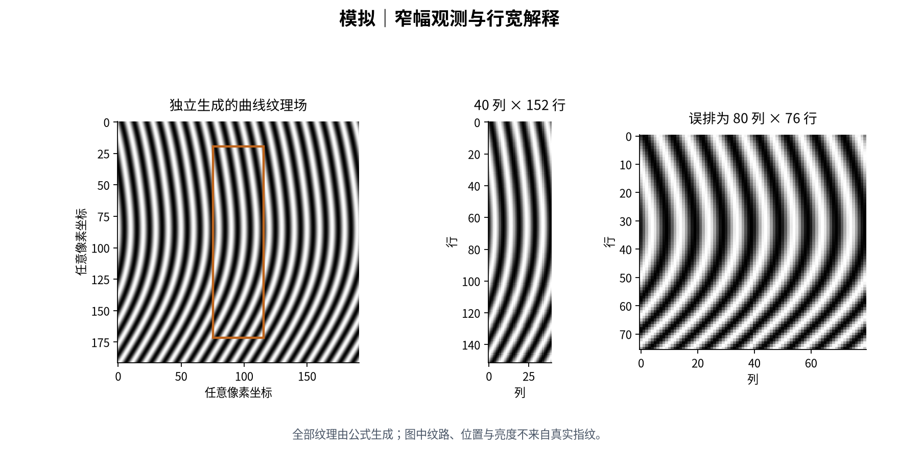
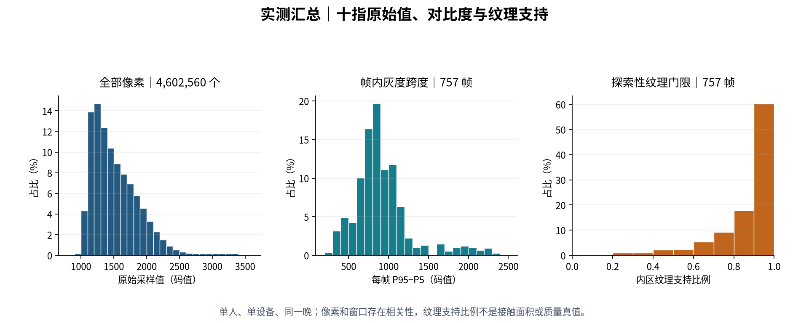
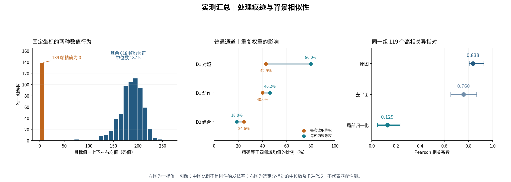
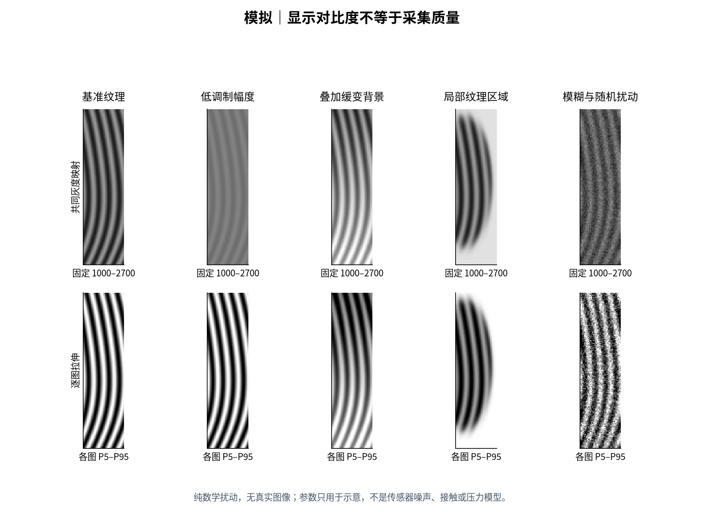
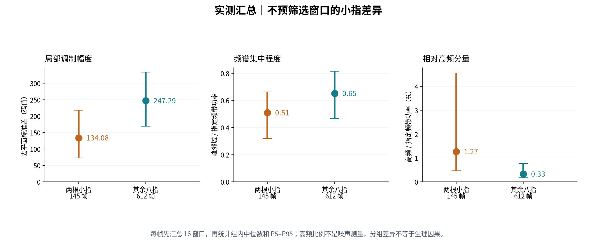
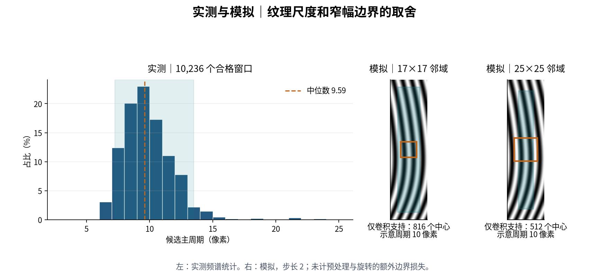
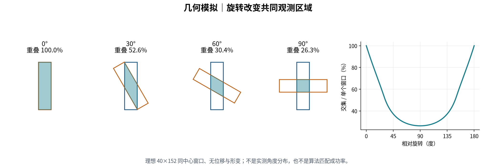
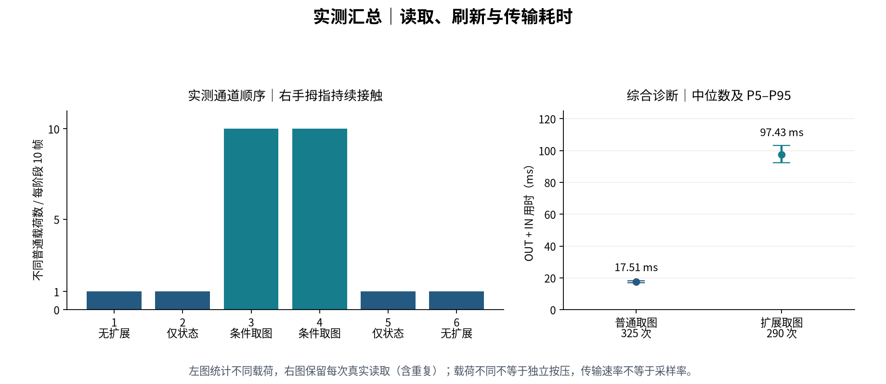

# FT9362 成像特性实验报告

本报告描述本机 FT9362（USB `2808:0752`）的数字图像布局、灰度与纹理尺度、局部覆盖、旋转以及采集刷新行为，为驱动、采集工具和匹配算法提供实验依据。数据来自 2026-10-11 至 12 日的一台设备、一名参与者。**十指录制用于空间成像分析；右手拇指诊断用于通信与时间行为分析，两者分别统计。**

所有纹理插图均由独立数学公式生成，没有使用、描摹或变换真实指纹。实测图只展示总体直方图、计数和耗时，不发布原始帧、逐帧特征、匹配对应点或个人纹路。本文是数字输出的实验报告，不是传感器物理规格书或认证性能报告。

## 1. 主要结论

| 结论 | 证据 | 工程含义 |
| --- | --- | --- |
| 当前图像应解释为 40 列 × 152 行 | 设备尺寸查询、Windows 布局证据、757 帧行连续性检查相互支持 | 保持窄幅几何，不将同一载荷重排成近方形图像 |
| 短边提供的纹理上下文有限 | 筛选窗口主周期中位数 9.59 像素；40/9.59≈4.17 | 匹配需要关注局部歧义、有效重叠与特征空间分布 |
| 帧间亮度与帧内灰度跨度变化明显 | 每帧中位值 1,076–3,240；P95−P5 为 252–2,400 | 显示拉伸与算法归一化分别设计，不能以全局亮度判断是否有手指 |
| 单个固定坐标呈两种数值行为 | 十指中 139 帧精确等于四邻域平均值，其余 618 帧均为正偏差；USB 诊断复现 | 输出可能已有条件补偿，不能将其视为纯 ADC 原样输出或身份纹理 |
| 小指差异在不预筛选窗口时仍存在 | 去平面局部标准差中位数 134.1，对照八指为 247.3；频谱更分散 | 质量需要识别低调制与复杂纹理，不能只放宽方向门限 |
| 协议有效不等于具有充分纹理 | 757 帧均通过格式校验；探索性纹理支持不足一半的有 37 帧 | 采集错误、图像质量不足和身份不匹配应分别表达 |
| 读取成功不保证缓冲更新 | 两轮通道实验中，普通读取及仅扩展状态查询均可反复得到同一载荷 | 刷新策略必须基于已验证的状态与取图序列 |
| 普通与扩展图像不能当作同步观测 | 静止时高度相关，滚动时对应相关性明显下降 | 不直接组成逐像素训练标签，不混为一个时刻的双通道输入 |

已确认的是本机、当前固件和所述采集条件下的行为。有效位深、物理 DPI、绝对接触面积、压力响应、曝光／积分过程、真实旋转角度、跨人员匹配性能均未测定。

## 2. 样本与实验条件

### 2.1 数据集分工

| 集合 | 采集条件 | 样本规模 | 用途与限制 |
| --- | --- | --- | --- |
| C：十指录制 | 同一人的十指，同一晚约 11 分钟内录制 | 10 个 SQLite 数据库，757 个普通帧 | 独立重新按压的成像变化；不能代表跨日期或人员总体 |
| D1：GUI 能力复测 | 右手拇指；通道对照与接触动作两个子实验 | 分别有 142、238 个有效响应，合计含 65 个普通图像、32 个扩展图像 | 持续按住、滚动、抬手、再按及通道对照 |
| D2：综合协议验证（版本 1） | 右手拇指；通道顺序、接触变化、持续采集与取消恢复测试 | 1,996 个已记录 BCC 的完整响应；含普通图像 325 个、扩展图像 290 个 | 整轮中断，使用已完成阶段，不把未执行项当作成功 |

D1 的计数仅限上述两个子实验，不是整轮诊断的总数。本文 D2 指版本 1 的中断轮次，不包含版本 2 的续测完成轮次；后者的取消恢复证据见[设备能力](device-capability.md#取消实验条件与覆盖范围)。D2 的 1,996 个响应包括语义拒绝的完整应答，不等于 1,996 次查询成功。两轮记录分别核验，不将早期协议诊断的相似结果重复计入。原始数据集不公开，本文使用 C、D1、D2 区分统计范围。

参与者确认 C 中各帧均在抬起后重新按下采集，其中部分是在旋转 90° 后录入，但具体帧没有标注；数据库没有逐帧接触事件或角度传感器记录。D1、D2 包含持续接触下的连续读取，不能按相同规则解释为独立按压。

参与者自述手较小。没有手指宽度、传感器有效物理尺寸或按压力测量，因此只将它记录为采集条件，不据此推导接触面积、像素密度或拇指与其他手指的成像优劣。拇指诊断成功也不能替代其他九指的刷新、质量和使用体验验证。

### 2.2 十指分布与独立性

| 手指 | 左手帧数 | 右手帧数 |
| --- | ---: | ---: |
| 拇指 | 76 | 105 |
| 食指 | 68 | 104 |
| 中指 | 76 | 49 |
| 无名指 | 68 | 66 |
| 小指 | 67 | 78 |
| 合计 | 355 | 402 |

共 13 条录制会话记录，其中 12 条非空、1 条空。左中指和右小指各有两个非空会话，其余八指各一个；所有会话都在同一晚。空会话不计入图像质量失败。帧数不均意味着总体帧分布偏向录制较多的手指；本文没有将 757 帧当作 757 名独立参与者。

### 2.3 完全重复与统计单位

重复检查直接读取原始数据库及诊断响应，验证帧结构与 BCC 后，比较完整的 12,160 字节像素载荷。相等指逐字节一致，不比较文件名、时间戳、协议头尾或显示图；不同通道按相同像素布局比较。下表的重复记录数为记录数减去不同载荷数，同组保留一条时其余均计为重复。

| 集合 | 图像记录数 | 不同像素载荷数 | 重复记录数 |
| --- | ---: | ---: | ---: |
| C：十指录制 | 757 | 757 | 0 |
| D1：通道对照 | 43 | 18 | 25 |
| D1：接触动作 | 54 | 50 | 4 |
| D2：综合协议验证（版本 1） | 615 | 572 | 43 |
| D1、D2 合计 | 712 | 640 | 72 |

诊断共有 11 个重复组，最大组含 17 条记录；这三个诊断子集之间没有完全相同载荷，与 C 也没有共同载荷。72 条重复均来自普通图像通道。本统计仅覆盖第 2.1 节定义的集合，不代表其他诊断文件。

各类统计采用与问题对应的单位：

| 统计问题 | 单位与权重 | 本文分母 |
| --- | --- | --- |
| 十指成像、质量与特征 | 每种完整像素载荷一次；低质量图像保留 | C 的 757 种图像，帧级统计均等权 |
| 诊断固定像素行为 | 每个实验、通道内的不同载荷等权；汇总时再跨通道去重 | D1、D2 合计 640 种内容；同时给出读取加权的敏感性 |
| 相邻双通道关系 | 保持真实时间邻接，按有序载荷对去重，不能删帧后重新拼邻居 | 四阶段各 7 个不同图像对 |
| 匹配对照 | 每个无序图像对一次；同一图像参与多个不同配对仍有相关性 | 全量 29,607 个同指对、256,539 个异指对；抽样实验另列 |
| 刷新、传输耗时与取消 | 每次真实事务均保留，内容相同也不合并 | 原读取次数和次序；重复次数是观察结果 |

C 没有完全重复，因而去重后的灰度、纹理、频谱、方向、空间支持和配对结果与记录加权相同。诊断内容统计会受重复权重影响，具体见第 4.2 节；不能用读取次数扩大固定像素现象的证据数量。640 种内容也不能解释为 640 次独立按压或已证明的新采样。采集工具保存每次完整帧，目前没有自动去重。

去重范围包含完整载荷，而非只比较疑似异常像素。不同图像即使该像素或某项统计相等，也应保留；同一事务在汇总文件与子记录中的引用仅算一次，不能当作又一次 USB 读取。

训练与内容评估应从保留原始记录的派生清单中按重复组取代表或统一组权重，且整组及其增强不得跨数据分区；采集端到端评估仍保留重复读取导致的重试、耗时及失败。少量像素变化属于近重复，不能仅凭不同载荷判定采集刷新，也不能用高相关自动合并：本数据存在背景主导的高相关异指图像。

## 3. 帧完整性与空间布局

### 3.1 字节解释

本报告仅对解码后的像素计算成像指标。完整保存格式仍为 `FT9362-RAW-v1`，长度 12,166 字节；协议细节及 Windows 依据见[协议文档](protocol.md)和 [Windows 移植参考](windows-reference.md#71-三种长度及原始图像布局)。

| 零基偏移 | 长度 | 含义 |
| --- | ---: | --- |
| 0 | 1 | 起始字节 `02` |
| 1–2 | 2 | 协议长度字段，大端解释 |
| 3 | 1 | 响应状态，图像成功应答为 `04` |
| 4–12,163 | 12,160 | 6,080 个小端无符号 16 位采样，按 152×40 排列 |
| 12,164 | 1 | 逻辑响应的 BCC |
| 12,165 | 1 | 当前实收包外尾字节；不作为像素或 BCC |

C 的十个数据库完整性检查通过，757 帧的长度、头部、状态及 BCC 均有效。757 个图像载荷互不相同，无跨指完全重复载荷。不同载荷只排除了逐字节重复，不能证明指纹覆盖不同、时间上独立或增加了身份信息。

### 3.2 行宽与中间边界检查



**图 1：纯模拟。** 同一数组可被任意重排，但重排会改变空间邻接关系。示例曲线的形态与真实样本没有对应关系。

为核对行宽，对每帧相邻两行分别去均值后计算 Pearson 相关系数，取全部行对的中位数；再对 757 个帧级结果计算分位数。以同一像素序列重排为 76 行×80 列作对照。常量行对的相关性未定义，计算时排除。

| 指标 | P5 | 中位数 | P95 |
| --- | ---: | ---: | ---: |
| 按 40 列排列的相邻行相关 | 0.830 | 0.896 | 0.960 |
| 按 80 列重排的相邻行相关 | 0.386 | 0.633 | 0.867 |
| 40 列布局中央行界的平均绝对差，码值 | 33.64 | 93.90 | 159.54 |
| 其余行界平均绝对差的帧内中位数，码值 | 35.92 | 93.30 | 136.91 |
| 中央行界差值 / 其余行界中位数 | 0.703 | 1.025 | 1.458 |

中央行界指零基第 75 与 76 行之间，其余 150 个行界构成对照；比值先逐帧计算，再统计。中间位置未呈现普遍的突变，支持将 152 行作为连续图像处理，不支持无依据地拆成两幅独立的 40×76 图像。

相关性受纹路方向与背景影响，不能独自证明布局；这里与设备查询及 Windows 主机证据联合使用。仍不能据此确认物理扫描顺序、安装方向、横纵像素间距是否相同或真实手指的上下左右。40×152 的 3.8:1 是数字阵列比例，不是已测得的毫米比例。

## 4. 灰度、精度与显示

### 4.1 原始采样统计

总计 4,602,560 个采样；未经右移、截断、反色、增强或逐帧归一化。

| 指标 | 最小值 | P5 | 中位数 | P95 | 最大值 |
| --- | ---: | ---: | ---: | ---: | ---: |
| 全部像素码值 | 880 | 1,104 | 1,440 | 2,176 | 3,540 |
| 每帧中位值 | 1,076 | 1,176 | 1,468 | 1,836 | 3,240 |
| 每帧 P95−P5 | 252 | 423.2 | 852.2 | 1,841.76 | 2,400 |

第一行将全部像素汇总；后两行先计算帧级指标，再统计其分布，两种统计单位不能混用。未出现 0 或 65,535，不代表没有模拟饱和，也不能证明传感器使用了全部 16 位精度。像素明暗与脊／谷的物理对应尚未由独立标定确认。



**图 2：实测汇总。** 左图分母为所有像素数，中、右图分母为 757 帧。右图的纹理支持定义见第 5 节；它不是手指覆盖率。

### 4.2 固定坐标的数值行为

4,602,560 个采样中有 96 个不是 4 的倍数，均位于零基行 41、列 37。直接从 SQLite 原始 BLOB 解码，并与分析数组逐值核对。定义该点相对上下左右四邻点的残差：

```text
e = I[41,37] − (I[40,37] + I[42,37] + I[41,36] + I[41,38]) / 4
```

- 139/757 帧的 `e` **精确为 0**，包括全部 96 个非 4 倍数值，以及 43 个仍为 4 倍数的值。
- 其余 618 帧的 `e` 全部为正，P5／中位数／P95 为 145／187.5／219 码值。
- 其余 5,699 个非边界坐标，精确等于四邻域均值的次数中位数为 8、最大 22；逐坐标残差中位数的绝对值最大 95，低于目标坐标的 182。
- 同手指、同会话的 745 个相邻独立按压对中，该点在“等于均值／不等于均值”之间切换 205 次，不能当作某根手指的固定特征。

相同检查在诊断中复现。712 条图像响应均核对实际 USB IN 拼接、完整响应、BCC 和像素切片；下面以**各实验、通道内不同载荷等权**计算固定像素行为。读取数仅说明采集规模，残差分位数排除 `e=0` 后计算。

| 数据与通道 | 读取数 | 不同图像数 | `e=0` 图像数 | 非零残差 P5 / 中位数 / P95，码值 |
| --- | ---: | ---: | ---: | --- |
| C 十指普通帧 | 757 | 757 | 139 | 145 / 187.5 / 219 |
| D1 通道对照普通 | 35 | 10 | 8 | 186.85 / 194.5 / 202.15 |
| D1 通道对照扩展 | 8 | 8 | 8 | — |
| D1 接触动作普通 | 30 | 26 | 12 | 175 / 193 / 217.2 |
| D1 接触动作扩展 | 24 | 24 | 10 | 176.95 / 197.5 / 216.05 |
| D2 普通 | 325 | 282 | 53 | 154 / 195 / 222.6 |
| D2 扩展 | 290 | 290 | 60 | 147.45 / 196 / 227.55 |

若按读取重复加权，D1 通道对照普通图像的 `e=0` 比例为 15/35＝42.86%，按内容等权则为 8/10＝80%；非零残差中位数相应为 186／194.5。D2 普通图像的比例为 80/325＝24.62% 与 53/282＝18.79%，非零残差中位数为 196／195。可见重复次数与像素状态并非无关，不能把全部读取直接用于估计成像分布。

合并诊断后，151/640 种图像精确等于四邻域均值，其余 489 种均为正偏差，非零残差 P5／中位数／P95 为 150.2／196／226 码值。读取加权则为 185/712、非零残差 152.6／196／229。两种权重下数值关系都存在，但这些比例仅描述所选内容或读取，均不能估计固件补偿的触发概率；尤其 D1 通道对照普通组仅有两幅非零残差图像。

所有分组的非零残差均为正；不是只有扩展通道才具有上述关系。四个相邻值是 4 的倍数时，其平均值可以落在任意整数，这为该位置低两位的变化提供了明确数值解释。**条件性的四邻域替换／补偿是强解释，但尚未证明固件内部实现、触发条件或物理坏点。** 不能将所有 `e=0` 自动标为已执行补偿，也不能从正残差推断全部偏差都来自硬件。

现象直接存在于保存的 USB 响应，不能归因于预览增强或模型处理。原始存储保持不变；算法验证须覆盖该坐标的两种状态和掩蔽消融，避免把固定位置处理痕迹当作纹理，不能未经设备范围验证就在所有 FT9362 上硬编码修补。

### 4.3 亮度背景与局部纹理

私有样本检查可见缓慢变化的背景、不同方向与曲率的条纹、局部纹理弱化，以及有效纹理区域随重新按压改变。它们说明输入不是固定亮度、固定位置的标准图案；但没有受控变量实验，不能把某一亮暗现象直接归因为干燥、潮湿、压力、增益或积分时间。

对每幅原始图像以最小二乘拟合 `a+bx+cy` 平面，计算拟合平面去均值平方和占原图去均值平方和的比例，P5／中位数／P95 为 0.48%／7.55%／42.86%；17 帧超过 50%。这是线性空间趋势可解释的方差，不是物理背景真值或噪声测量，也不意味着应直接扣除全部拟合成分。

帧内 P95−P5 同时包含脊谷调制、接触边界及低频背景。一个大跨度的图像可能只有很少的清晰纹理；一个低跨度图像经拉伸后可能看起来很清楚。生产质量判断应检查局部证据，而不是只比较整帧跨度。

同一手指内的变化也很大。对帧级指标按手指分组作平方和分解，**手指内波动占总亮度中位数变异的 49.54%，占总 P95−P5 跨度变异的 87.57%**。每指 P95/P5 跨度比再取十指中位数为 2.52；同手指同会话相邻独立按压中，80/745 对的较大跨度超过较小跨度两倍。该分解没有控制时间、姿态和皮肤位置，不能将手指间剩余部分称为生理效应，但足以说明对比度不是稳定身份属性。

全体 256,539 个异指帧对中，有 119 对原图 Pearson 相关 ≥0.8，涉及 43 帧；其中 89 对至少含一幅小指图。对**同一批帧对**比较处理后的相关性：

| 处理 | P5 | 中位数 | P95 |
| --- | ---: | ---: | ---: |
| 原图去均值相关 | 0.807 | 0.838 | 0.928 |
| 各帧扣除拟合平面后相关 | 0.653 | 0.760 | 0.868 |
| σ=3 背景抑制及局部 RMS 归一化后相关 | 0.048 | 0.129 | 0.233 |

局部归一化后这 119 对均低于 0.8。高原图相关并不证明纹理接近；扣除平面也不足以去掉全部共同成分。上述结果支持研究局部强度稳定性，但**不是归一化后的识别率**：帧对是按原图高相关挑选，处理也会改变真实纹理，须另查全部同指与异指任务。该 σ=3 对照的反射边界不符合正式描述子的完整支持要求，不直接移入生产前处理。



**图 3：实测汇总。** 左图为 C 的唯一图像残差，中图为诊断固定像素比例在读取加权与内容等权下的差异，右图为同组异指对的相关分位数；不含真实图像或逐帧数据。



**图 4：纯模拟。** 上排共享显示范围，下排逐图用 P5/P95 拉伸。同一低调制纹理经拉伸后可以获得很强的显示对比；扰动也会被放大。该图没有拟合设备噪声，不用于估计信噪比、MTF 或真实压力响应。

建议保留原始精度，将预览映射参数记录清楚；分析亮度漂移时使用共同映射，检查纹理时可辅助使用逐帧映射。算法中的去背景、局部归一化及噪声下限需要单独验证，不能直接继承 GUI 为显示而选择的变换。

## 5. 纹理支持与局部尺度

### 5.1 局部纹理与质量观测

用原始图像的高斯平滑结果（σ=0.8 像素）计算梯度，再用 16×16 均值窗口计算结构张量。令 `Jxx=mean(gx²)`、`Jyy=mean(gy²)`、`Jxy=mean(gx·gy)`，方向一致性定义为：

```text
coherence = sqrt((Jxx − Jyy)² + 4·Jxy²) / (Jxx + Jyy + 1e−9)
```

同时计算原始值的 16×16 局部标准差。将一致性 ≥0.5 且标准差 ≥40 码值的位置视为探索性的纹理支持；去除四边 8 像素，仅在 136×24＝3,264 个内区位置统计比例。

| 指标 | 结果 |
| --- | ---: |
| 纹理支持比例 P5 / 中位数 / P95 | 0.520 / 0.941 / 1.000 |
| 支持比例 <0.5 | 37/757 帧（4.89%） |
| 支持比例 <0.25 | 10/757 帧（1.32%） |

这些门限是用于定位需检查样本的分析配置，尚无质量标注支持其生产使用。方向一致性低可能来自弱纹理，也可能来自曲率、端点或分叉；平行重复条纹则可能一致性高但身份区分力弱。内区支持比例还主动排除了边缘，不能当作全图有效面积，更不能当作物理接触面积。

低支持样本明显集中于小指：

| 分组 | 总帧数 | 支持比例 <0.5 的帧数 | 组内比例 |
| --- | ---: | ---: | ---: |
| 左小指 | 67 | 20 | 29.85% |
| 右小指 | 78 | 14 | 17.95% |
| 其余八指 | 612 | 3 | 0.49% |

因此总体 4.89% 不能代表每根手指的情况，质量与录入评估必须按指分组。这只能说明该门限下的纹理表现有差异，尚不能归因为手小、接触不足或小指固有质量差；门限自身也可能对不同曲率和方向存在偏差。

用无周期纹理的合成斜坡 `I(x,y)=1200+9x` 检查同一计算流程，其内区支持比例仍为 100%。这证明一致性与标准差只能反映有方向的灰度变化，不能单独证明存在脊线。频谱周期性、局部结构及实际匹配表现应作为后续质量规则的独立验证依据，不能把本门限直接用作背景掩码。

对门限组合的敏感性检查如下，表内为支持比例 <0.5 的帧数，分母均为 757：

| 一致性下限 | 标准差 ≥20 | 标准差 ≥40 | 标准差 ≥80 |
| --- | ---: | ---: | ---: |
| 0.3 | 3 | 3 | 25 |
| 0.5 | 37 | 37 | 53 |
| 0.7 | 202 | 202 | 207 |

该统计对方向一致性门限尤其敏感；37 不是传感器固定的坏图数量。所有低支持样本保留在总体分析中，不通过删去困难样本改善结果。

为检验小指差异是否仅由上述门限造成，对全部 757 帧取 12,112 个 32×32 窗口：横向起点为 0、8，纵向为 0 至 112、间隔 16。**不预先筛除任何窗口**。每窗最小二乘去平面，乘二维 Hann 窗并作 64×64 补零 FFT；每帧对 16 窗指标取中位数，再按两根小指 145 帧和其余八指 612 帧汇总。

| 帧级指标中位数 | 两根小指 | 其余八指 | 含义 |
| --- | ---: | ---: | --- |
| 去平面局部标准差，码值 | 134.08 | 247.29 | 局部调制幅度明显不同，但不是脊谷真值幅度 |
| 1/24–1/3 周期/像素频带的功率比例 | 91.53% | 95.49% | 分母为半径 (0,0.5] 的频谱功率，不是整幅图像总能量 |
| 共轭峰附近集中度 | 0.509 | 0.652 | 峰邻域半径 0.04 周期/像素，相对上述频带总功率 |
| 高频／上述频带功率 | 1.275% | 0.331% | 高频为半径 (1/3,0.5]；相对比例较高不等于绝对噪声较大 |



**图 5：实测汇总。** 点为组内中位数，线为帧级 P5–P95，不是置信区间。两组帧数量、手指及会话分布不同，未标记的大角度样本所占比例也未知，并非独立人员或已控制姿态的生理对照。

两种分析共同说明小指差异并不完全由一致性门限制造：原始局部调制更弱、功率更分散同时存在。但高频可能包含脊线谐波、边界、细节或噪声，且分母下降会抬高比值；不能将 3.85 倍的比例差称为“小指噪声大 3.85 倍”。频谱集中度与上述支持比例的帧级 Spearman 相关为 0.773，二者有关联但不是同一指标；不能用任一项单独淘汰小指。

### 5.2 主周期估计

每帧取 16 个 32×32 窗口：横向起点为 0、8；纵向为 0、16、32、48、64、80、96、112。首先要求窗口中心满足上述一致性与标准差门限，然后：

1. 从窗口减去高斯 σ=4 的低频背景，乘二维 Hann 窗。
2. 补零至 128×128 后计算功率谱，在频率模长 1/24 至 1/3 周期/像素内寻找最大峰。
3. 计算该峰及其共轭峰周围半径 0.025 周期/像素的频带内能量；占整个搜索频带能量至少 25% 才接纳。
4. 将峰值频率模长的倒数作为候选主周期。

12,112 个候选窗口中有 10,236 个通过筛选，来自 756 帧。一个没有合格窗口的帧只缺少该指标，并未从其他分析删除。

| 周期统计 | 最小值 | P5 | 中位数 | P95 | 最大值 |
| --- | ---: | ---: | ---: | ---: | ---: |
| 候选主周期，像素 | 5.76 | 7.23 | 9.59 | 13.49 | 23.77 |

为检查窗口数量对统计的影响，先对每帧合格窗口取中位数，再对 756 个帧级结果统计，P5／中位数／P95 为 7.80／9.59／12.36 像素。分别汇总每根手指的合格窗口，其周期中位数范围为 8.61–10.67 像素。两种汇总仍支持约 10 像素的尺度参照，但不能将它固定为所有区域的统一脊距。

窗口高度重叠，每帧通过数量不同，原表按合格窗口计数；帧级汇总则给每个具有合格窗口的帧相同权重，两者都不是等权手指分布。筛选偏向方向较一致且有对比的纹理；峰值可能是谐波或剩余背景。补零用于更密地采样频谱，不增加原窗口的真实频率分辨率。不能将这些数值直接称为所有区域的脊距，更不能结合“通常的指纹尺寸”反推本机 DPI。

逐帧先汇总窗口周期，再计算每指的帧级 P95/P5，比值在十指上的 P5／中位数／P95 为 1.34／1.44／1.67。固定手指也没有固定的图像周期。它混合了采样位置、方向、局部脊距、按压变化及估计误差，不能换算为皮肤拉伸率或任意设置几何缩放容差；正式训练须覆盖观测尺度变化，几何容差仍依据已核验对应校准。

### 5.3 方向分布与局部歧义

在上述合格频谱窗口中，将峰值法向旋转 90° 得到模 180° 的纹路切向 `θ`，只对至少四个合格窗口的帧统计。每个窗口等权，以 `R=|mean(exp(2iθ))|` 描述帧内轴向集中度；合成角度平均只用于纹路方向，不用于恢复手指姿态。

745 帧满足窗口数量条件，R 的 P5／中位数／P95 为 0.574／0.951／0.993。其中 630 帧的 R≥0.8，其主方向在原图数组坐标中的分布为：

| 角度区间 | 帧数 |
| --- | ---: |
| [0°,30°) | 151 |
| [30°,60°) | 120 |
| [60°,90°) | 42 |
| [90°,120°) | 48 |
| [120°,150°) | 138 |
| [150°,180°) | 131 |

轴向角从正列方向起，行方向向下；共轭峰给出同一轴向。合格窗口筛选偏向有方向的纹理，且窗口重叠，不能将高 R 外推为整幅都是直线。统计支持两项工程判断：可利用局部方向缩小候选，但跨样本不能固定只搜某一方向；许多局部区域方向相近，增加同类点数并不等于增加独立身份信息。

该分布混合了不同手指、皮肤位置、天然曲率和按压转角。它既不能定位操作者所说的 90° 样本，也不能证明每一角度区间的真实按压数量；未标注样本继续保持角度未知。

### 5.4 局部支持与有效取样区域



**图 6：左为实测汇总，右为独立模拟。** 右侧橙框表示邻域，青色表示中心不越界的范围；颜色不是质量判断。

以中位周期 9.59 像素作尺度参照，17 像素边长约为 1.77 个周期，25 像素约 2.61 个，40 像素约 4.17 个。方向和曲率改变实际穿过邻域的纹路数量，因此只是上下文规模的估计。

对于步长为 2、中心落在偶数像素坐标、邻域必须完全位于图内的候选设计：

| 方形支持 | 边缘留白 | 有效中心网格 | 中心数量 |
| --- | ---: | ---: | ---: |
| 17×17 | 四边各 8 像素 | 68×12 | 816 |
| 25×25 | 四边各 12 像素 | 64×8 | 512 |

上述计数仅考虑轴对齐卷积邻域，不含空间预处理、旋转重采样或质量掩码。预处理若在原图各侧额外依赖半径 `r` 的像素，总半径是卷积半径加 `r`；多个局部操作应沿依赖链累加。

| 25×25 卷积前的额外依赖半径 | 完整支持网格 | 中心数量 |
| --- | ---: | ---: |
| 0 像素 | 64×8 | 512 |
| 1 像素 | 63×7 | 441 |
| 2 像素 | 62×6 | 372 |
| 4 像素 | 60×4 | 240 |

例如依次计算 σ=3 高斯背景、残差及残差平方的 σ=3 高斯局部均值，在各次高斯截断半径为 12 时，最终值可依赖各侧 24 像素。再接 25×25 卷积，总半径为 36，短边没有完整支持位置。反射填充可以定义边界数值，但这些输出不再满足“所有空间依赖均来自实测区域”的条件。

预处理与特征提取因此必须一起选型。图 6 的 512 与 816 是卷积自身的几何上限，不是最终可匹配点数；旋转邻域与插值还须另算原图支持。扩大卷积支持可能减少重复纹路歧义，同时使该几何上限减少约 37.3%。这些中心的邻域彼此重叠，不是 816 或 512 个独立特征。应同时比较支持尺度、跨按压可重复性、有效区域分布和误匹配，不能仅按网络容量或检测点数量选型。这些方形卷积支持用于说明边界代价；正式设计采用圆形块及方向池化，具体网络与 BRISK 排除依据见[算法设计](matching-design.md)。

正式设计采用圆形支持，保守预留 13 像素边界，中心网格为 7×63。将第 5.1 节的探索性掩码投到该网格，与同节的 136×24 内部区域比较。全体帧中，中心区域支持比例减去原内部比例的 P5／中位数／P95 为 −0.042／0.001／0.046，仅一帧降低超过 0.2。

| 分组 | 原内部支持中位数 | 中心区域支持中位数 | 网格通过探索门限的中心数中位数 |
| --- | ---: | ---: | ---: |
| 两根小指 | 0.739 | 0.754 | 333 / 441 |
| 其余八指 | 0.960 | 0.974 | 430 / 441 |

没有帧在该网格上少于八个过门限中心，因此已有数据不支持“边界收缩使小指普遍无点可取”。不过这是**单帧中心处的探索性掩码**，既不检查整个圆形块，也未执行稀疏选点、可靠性筛选或跨图对应，不能证明有八个有效内点，更不能证明取样方案已经可认证。

## 6. 位姿、覆盖与形变

操作者确认部分样本在旋转 90° 后录入，具体帧未知。独立按压改变的不只是图像坐标，也可能改变实际接触的皮肤区域及局部形变。当前没有可靠的逐帧旋转、平移、压力或共同覆盖真值；不能把配准程序给出的最优变换直接当作真实位姿。产品仅要求适度旋转容忍：认证相对录入基准 ±30°、录入 ±15°，均为待验证的设计边界；90° 是数据条件与超范围对照，不是识别成功要求。



**图 7：纯几何模拟。** 两个理想 40×152 矩形位于同一中心，不考虑平移、形变与像素间距差异。青色为交集，纵轴分母为一个窗口面积，不是交并比。相对旋转 90° 时交集为 40×40，比例为 40/152≈26.3%；180° 时覆盖完全相同，但像素顺序反向。

真实两次按压未必同中心，局部有效纹理区也未必填满矩形。该图只解释为什么“方向能够对齐”仍不保证“有足够共同内容”，不是本批样本的重叠分布或匹配成功率。普通旋转不应以镜像增强替代；镜像改变纹理的几何关系。

描述子的完整支持还会进一步缩小共同中心范围。正式设计在两幅图中均预留 13 像素边界；对理想同中心 90° 按压，各自可取样的整数中心为 14 列×126 行，其共同中心范围仅约 14×14。将一幅的步长 2 网格变换到另一幅，441 个候选中心只有 **49 个**落入另一幅完整中心范围，尚未经过 128 点上限和质量筛选。

49 是可描述位置的几何计数，不是可匹配点数；90° 旋转还会使固定奇数网格在一条轴上错开一个像素，需要处理采样相位。原图 26.3% 的重叠不能直接保证八个几何内点。对规定范围内的角度，上线应分别检查原始共同区域、可完整描述区域、选中中心和最终内点，避免把裁剪与选点损失全部归为“用户没按好”。

匹配设计应区分：

- **方向与位置差异：** 需要旋转下的对应和几何验证，不能只在固定图像位置比较特征。
- **共同覆盖不足：** 再强的旋转归一化也不能恢复未采到的皮肤区域，需要多次独立录入或重试。
- **接触形变：** 可在可靠局部对应基础上研究受限形变容忍，不能用过度自由的变换强行拟合异指。
- **可用纹理不足：** 清晰局部的支持、分布与独立证据量必须足够；整图亮度变化不替代这些证据。

本批数据支持设计中保留这些问题，不支持宣称某个具体变换模型、网络或阈值已经解决它们。

## 7. 通道刷新与时间特性

### 7.1 普通读取和扩展访问

D1 在一次持续接触中按 A→B→C→D 各取 8 帧：仅普通读取为 1 个不同载荷；加扩展状态查询仍为 1 个；在扩展状态 05 后取扩展图像为 8 个；停止扩展访问后又固定为 1 个。D2 记录的通道顺序为“无扩展、仅状态、条件取图、条件取图、仅状态、无扩展”，各 10 帧的不同载荷数为 1、1、10、10、1、1。



**图 8：实测汇总。** 条件取图指查询扩展状态 `82 73 01`，仅在返回 05 时执行 `82 76 01`。图中没有切换扫描／手势／睡眠模式，不能将这些阶段描述为不同硬件成像模式。

两轮结果支持扩展取图参与推进后续普通缓冲更新，且该作用不是一次开启后永久连续刷新。仍未定位设备内部采样触发点，因此“不同载荷”不直接等于一次新的 ADC 积分。返回速度也不能直接作为真实采样帧率。

### 7.2 普通与扩展图像的关系

普通与扩展图像均返回 12,160 字节像素，实收响应 12,166 字节；它们具有相同的数字布局，不证明同时采样、相同处理或同等匹配质量。

为避免把手势切换混入比较，仅在 D1 每个阶段内部配对：8 个普通帧 `N0…N7` 与各自随后读取的 8 个扩展帧 `E0…E7`；比较 `Ei` 与同阶段下一普通帧 `N(i+1)`，每阶段 7 对，舍弃末端无后继的 `E7`。计算未经配准、未经灰度映射的整幅 Pearson 相关及平均绝对差。四阶段共 28 个有序对、56 幅参与图像均不同，对内两幅载荷也不相同，因此此处去重不改变分母或数值；同一手指持续接触仍使它们具有时间相关性。

| 阶段，均为右手拇指 | 对数 | 相关 P5 / 中位数 / P95 | 绝对差中位数，码值 |
| --- | ---: | --- | ---: |
| 通道对照中的条件扩展 | 7 | 0.99806 / 0.99819 / 0.99828 | 8.45 |
| 按住不动 | 7 | 0.99860 / 0.99974 / 0.99980 | 9.88 |
| 保持接触并滚动 | 7 | −0.05533 / 0.10782 / 0.96572 | 235.67 |
| 再次按住 | 7 | 0.99542 / 0.99888 / 0.99895 | 9.57 |

静止时两次观测可很相似，移动时关系明显变化。低相关可能来自位置、角度、形变或时序差异，不能单独认定某通道质量差；高相关也不证明像素相同、硬件同步或只有随机噪声。差值包含生物接触变化、设备处理与时序，不用它估计传感器读出噪声。

这些通道数据只适合研究刷新、延迟和外观关系。当前没有随机交叉、同步参考和独立质量标注，不能证明扩展图像优于普通图像，也不能直接用相邻双通道数据监督像素级特征学习。

### 7.3 持续采集、接触动作与状态

D2 的轻触、常规按压、滚动阶段分别取得 12、12、16 个不同普通载荷，并取得等量扩展帧。“轻触／常规按压”来自操作提示，没有测力仪或压力标签；计数证明该流程可获得变化数据，不证明三个条件下质量相同，也不是压力与对比度的标定曲线。

约 60.135 秒的持续采集得到 178 个不同普通载荷、178 个扩展图像。报告交付速率约 2.960 帧/秒，包含每轮 100 ms 人为间隔、状态查询、Python 和记录开销。177 个样本记录时间间隔的 P5／中位数／P95 为 311.45／335.71／366.73 ms，最大 401.46 ms。时间戳记于普通取图及读后状态查询完成后，不是设备采样时刻。不能据此认定设备最大帧率，也未验证长时间稳定性、温升或功耗。

D2 全部已校验完整图像响应的主机传输耗时如下；每项为一次查询实际 OUT 与全部 IN 的耗时之和，不含相邻查询和人为等待。时间统计保留重复读取，因为每次确实发生了传输；图像载荷重复不使事务无效。

| 类型 | 次数 | P5，ms | 中位数，ms | P95，ms |
| --- | ---: | ---: | ---: | ---: |
| 普通取图 | 325 | 16.83 | 17.51 | 18.24 |
| 扩展取图 | 290 | 92.38 | 97.43 | 103.05 |

作为内容重复的分层检查，普通通道 282 种载荷各取本组首次读取，耗时 P5／中位数／P95 为 16.82／17.47／18.11 ms；其余 43 次重复读取为 17.24／17.92／18.65 ms。扩展通道没有完全重复，分层前后相同。首次出现只是在记录中首次见到该内容，不保证是一次新采样；两组也没有控制访问阶段，不能把耗时差解释为缓存的因果效应。正式事务耗时仍采用上表全部读取。

抬手阶段 3 次普通读取只有 1 个不同载荷，读取前普通状态为 01、00、00，而扩展状态均为 06。结合持续接触时普通读取也会使 01→00，可确认普通状态不是可靠的物理接触电平。06 仅有当前动作条件下的关联，不能自行扩展为任何设备状态下的“手指离开”定义。详细状态与取消残留见[设备能力](device-capability.md)。

## 8. 对工程实现的指导

| 环节 | 本批证据支持的处理原则 | 应验证的结果 |
| --- | --- | --- |
| 帧解码 | 固定区分协议头、像素、BCC 和包外字节；保留原始 16 位值及 40×152 几何 | 已知布局与边界样本解码一致，不静默裁剪或重排 |
| 采集状态机 | 区分普通缓冲读取、扩展状态和条件扩展取图；状态码不直接等价于物理手指事件 | 长按、重新按压、抬手及取消恢复下无错误复用或残留解析 |
| 样本记录 | 保留原始事务、会话、手指、通道及动作；派生清单标记完整载荷重复组 | 成像按唯一内容、时序按真实事务；重复组及增强不跨训练与测试分区 |
| 预览与分析 | 分开保存原始数据、显示映射及算法输入；提供一致灰度下的对照 | 显示效果变化不会被误记为采集质量提升 |
| 预处理 | 比较去背景、局部归一化与保留原始对比信息的方案 | 提高跨按压稳定性，同时不放大低纹理区或擦除有用结构 |
| 质量评价 | 联合局部纹理、空间覆盖、异常值和任务表现；不要照搬本报告探索门限 | 按指报告质量重试及匹配表现，特别检查小指；困难样本保留在总体分母 |
| 录入 | 多次真实抬起再按，覆盖不同位置和方向；冗余由有效信息而非文件数决定 | 留出按压与录入视图有足够覆盖，同时模板大小有界 |
| 匹配 | 先比较局部特征在重新按压下的对应，再评价几何和图库拒绝 | 明确同指低重叠与异指重复纹理两种错误来源 |
| 算法部署 | C++ 仅依赖标准库，离线分析环境与部署分离 | 最终数值与参考计算核对，构建和运行无第三方算法库依赖 |

这些原则不要求立即增加通用框架、复杂融合或更多模型。当前资料用于约束输入、支持范围和失败场景，不能证明认证性能。[算法设计](matching-design.md)确定正式特征、匹配架构与验收要求，权重和认证阈值由隔离数据训练、校准。

## 9. 未知项与补充实验

后续实验应优先补足会影响实现决策的证据，分别控制变量，避免将亮度、接触与身份混在同一个结论里。

| 问题 | 实验与记录 | 可支持的决策 |
| --- | --- | --- |
| 固定坐标处理机制 | 固定目标下交替查询普通／扩展图像，记录四邻域残差、亮度及设备状态；跨设备复测 | 区分条件补偿、传感器偏置与场景结构，决定是否需要设备专用校准 |
| 跨日期是否稳定 | 不同日期重新录制同一批手指；保留失败按压、会话与采集条件 | 预处理及质量规则是否只适合当晚数据 |
| 小手与覆盖的关系 | 自愿记录指腹宽度和设备有效区域尺寸；多名不同手型参与者按相同协议录制 | 区分个人条件与传感器普遍限制；不可仅以主观“小手”分组 |
| 位姿与重叠 | 约定角度和位置的独立按压，记录定位参考；对重叠标注做人工复核 | 旋转搜索范围、录入视图数及低重叠重试规则 |
| 质量与接触条件 | 分离轻触、常规按压、滚动等动作；记录湿度与皮肤状态；若要定量压力曲线则需测力 | 质量模型的可解释变量，避免把指令当作物理测量 |
| 通道质量和时序 | 固定刷新前提，重复并平衡访问顺序；尽量保持接触；记录所有查询和时间 | 是否有必要使用扩展像素，是否存在可利用的时延关系 |
| 固定位置低位异常 | 同坐标多会话对照、稳定目标或可解释的校准条件，结合固件路径 | 是否需要特定坏点处理；未确认前不改像素 |
| 采样率和噪声 | 将主机等待与读出分开；使用稳定参考及新采样证据 | 最大有效刷新率、时间噪声；单靠按手指的帧差不能得到 |
| 身份区分能力 | 更多人员、未登记手指；训练／选型／阈值校准／最终测试隔离 | 误接受、误拒绝、录入失败和质量重试的联合验收 |

本批数据已经用于成像分析和方案探索，不能再当作完全未见的最终测试集。757 帧和上万个重叠窗口都不增加参与者数量；同一人的十指可以检查部分异指混淆，不能证明跨人员泛化或极低误接受率。

## 10. 配准与局部特征对照方法

配准对照用于诊断固定坐标、角度搜索和重复纹理的影响；局部二进制对照用于区分点不足与对应不足。具体设计取舍在[算法设计](matching-design.md)相应环节说明。

| 对照 | 本批结果 | 能支持的判断 |
| --- | --- | --- |
| 未对齐整图 Pearson 相关，全部帧对 | 同指中位数 0.050，异指 0.020；异指最大 0.962，高于同指最大 0.927 | 固定坐标和全局亮度不能直接认证 |
| 局部归一化后仅平移，100 个同指／90 个异指对 | 中位数 0.288／0.230，几何交集至少 25% | 本配置的两类分数仍重叠 |
| 同组加入 0–345°、步长 15° 搜索 | 中位数 0.603／0.548，P95 为 0.824／0.757 | 更多搜索机会也抬高异指分数，峰值不能直接成为认证结果 |
| 57 点小环配置，300 个同指／270 个异指对 | 同指 22 对达至少 4 内点，15 对达至少 6；异指均不足 4 | 配置在本批任务上支持不足，不能以四内点作为认证阈值 |

相关对照种子为 9362，每指抽 10 个同指对、每个异指组合抽 2 对；100 个同指对、90 个异指对均无重复图像对。减去 σ=3 高斯背景，再除以残差局部 RMS 与 20 的平方和开方，使用反射边界。双线性旋转展开画布，排除无效重采样位置，在几何交集内去均值并搜索全部整数平移。掩码未排除预处理邻域触及边界，也未筛除低纹理；25% 是画布交集，不是可匹配纹理比例。该原图对照不符合正式模板约束，不发布 FAR／FRR。

小环对照采用半径 0／2／4／6／8、共 57 点的自定义模式，220 位描述，先作每帧 P5／P95 映射并以 3×3 均值平滑后双线性采样。FAST 阈值 20、点间距至少 4、边缘留白 10、上限 64；没有加入质量或弱方向拒绝。检测点数中位数 245、边界筛选后 123、最终 64，只有 3 帧不足 8 点。种子 9362，每指 30 个同指对、每个异指组合 6 对；300 个同指对、270 个异指对均无重复图像对。双向最近邻、两侧距离比 <0.8、归一化汉明距离 <0.35。刚体构造基线至少 12 像素、长度差 ≤3，以 ≤3 像素残差计内点；同指内点中位数为 0，异指最大为 3。

此处内点只是几何自洽，没有物理对应真值。小支持、弱方向、采样偏移、质量与真实重叠的贡献未分离，不推广为所有 BRISK 不可行；统计也不等同于含质量筛选和内点重估的完整目标流程。大量配对共享同一批手指，不能视为独立认证试验。

## 11. 复核方法与公开材料

### 11.1 分析约定

- 数据库通过只读连接访问；分析前后核对文件哈希。D1、D2 将保存的响应与实际 IN 字节拼接结果核对，再检查长度、状态、BCC 和图像载荷。原始文件未修改。
- 去重键为像素布局及全部原始像素字节，最终逐字节核对；另以整行像素数组的唯一值计算交叉验证。去重后仍保留人员、按压和会话相关性，不把唯一内容视为独立试验。
- 像素解码使用小端 `uint16`，计算前转为浮点。除明确列出的探索性频谱筛选外，不删除低质量帧；不把诊断图像并入 C 的分布。
- 第 5.1 节未筛选频谱分析采用全窗口、去平面与 64×64 FFT，第 5.2 节周期分析采用方向筛选、σ=4 背景抑制与 128×128 FFT；两者的峰邻域和分母不同，不直接比较集中度数值。
- 组内变异采用帧级指标的手指内离差平方和／全部离差平方和；高相关异指对复用完全相同的 119 对，未重新按预处理结果选样。
- 分位数使用 NumPy 默认线性插值。本文 P5／P95 是样本分位数，不是置信区间；GUI 某些统计使用整数次序统计，末位数值可能不同。
- Pearson 相关使用去均值内积除以两侧范数；常量输入的相关未定义。平均绝对差在原始码值域计算，没有先做配准或归一化。
- 滤波边界为 reflect；梯度使用 NumPy 的有限差分；16×16 局部统计使用 SciPy 均值滤波。频谱门限在窗口中心判断，搜索和共轭能量范围按第 5 节定义。
- 灰度直方图以 100 码值分箱；帧跨度同为 100；纹理支持比例以 0.1 分箱；周期以 1 像素分箱。左闭右开，最后一箱包含右边界，所有相应样本均落在绘图区间。
- 参考计算环境为 Python 3.14.7、NumPy 2.5.2、SciPy 1.18.1；绘图使用 Matplotlib 3.11.1。这些仅是离线分析依赖，不进入 C++ 算法库。

### 11.2 图件与复现边界

公开的[汇总数据](images/imaging/measurements.json)保存直方图、计数、分位数、配对对照及阶段级时间统计；同时记录各类统计单位、唯一内容数、读取加权与内容等权的敏感性。[绘图脚本](images/imaging/render.py)只读取该汇总文件，不打开数据库、诊断目录或设备；算法示意使用固定配置和独立合成纹理。已有相应离线环境时可在仓库根目录重新生成成像报告的八幅图和算法设计的四幅示意图：

```sh
python docs/images/imaging/render.py
```

脚本通过 fontconfig 选择中文字体，也可通过 `IMAGING_FONT` 指定字体文件。它使用如下独立纹理场，坐标与参数独立设定，不拟合个人纹路：

```text
I(x,y) = 1600 + 400·cos(2π·[x + 0.0025·(y−70)² + 2·sin(y/25)] / 10)
```

显示示意另行施加固定的幅度变化、线性背景、平滑区域掩码、σ=2 模糊及标准差 90 的随机扰动；随机种子为 9362。旋转图由矩形多边形求交计算，不包含纹理或实测位姿。模拟图只解释机制，不增加本机实验证据。

公开材料可复现图件、核对分母和数值，并按本文方法设计复测；不包含原始指纹或逐帧分析数据，不能代替原始输入重新计算像素统计。

相关文档：[设备能力与验证边界](device-capability.md)、[协议与数据格式](protocol.md)、[算法设计](matching-design.md)、[开发指南](development.md)。
