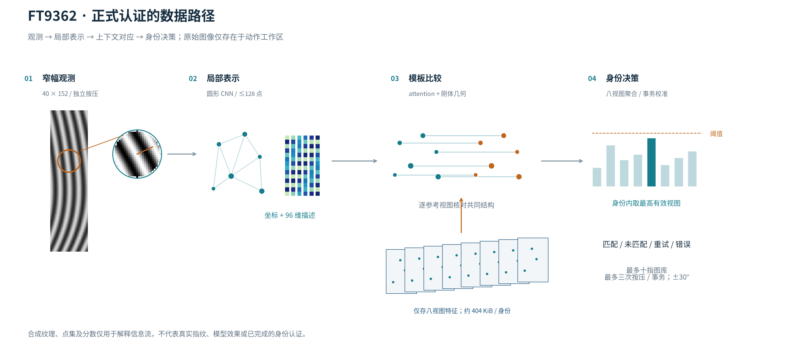
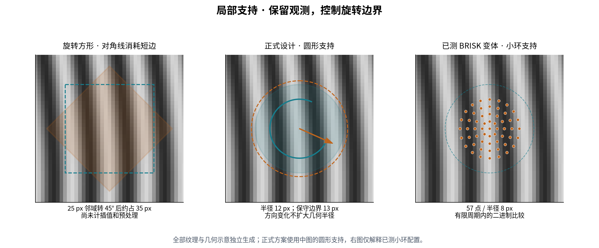
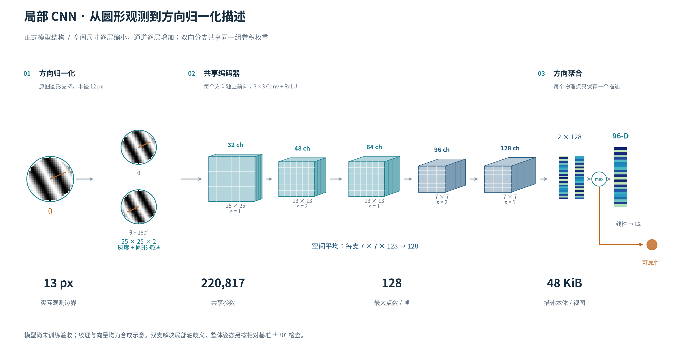
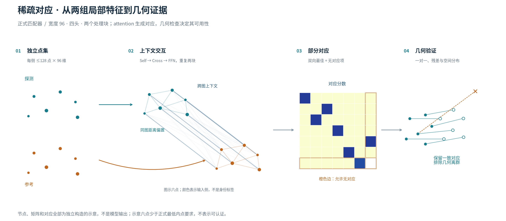

# FT9362 指纹匹配算法设计

本文规定 FT9362 正式身份认证的完整目标设计：从传感器观测、质量判断、局部表示和多次录入，到对应、身份判定、模板、接口及发布验收。设计针对 **GPD Pocket 4（Ryzen AI 9 HX 370、Radeon 890M、32 GB）**，部署算法不引入第三方库。

**正式路径确定为：圆形支持的方向归一化局部 CNN → 稀疏 attention 对应 → 刚体几何验证 → 多视图身份评分。** 每个环节有明确职责，BRISK、整图相关和手工梯度描述不作为备用认证通道。网络结构、容量、旋转容限、模板和动作契约在本文确定；训练权重与认证阈值是按规定数据和验收流程产出的发布资源。

当前驱动仍保存原始帧并采用旁路匹配，尚不能用于身份认证；本文规定的是要实现和验收的产品，**不是已经训练或验证完成的算法**。当前一人的数据能确定重要成像约束，不能证明最终准确率或最优性。详细实测和方法见[成像实验报告](imaging-characteristics.md)，通信事实见[设备能力](device-capability.md)。公开图件不含真实指纹。

## 1. 设计依据与适用范围

### 1.1 当前数据决定的问题

| 已有证据 | 对设计的直接约束 |
| --- | --- |
| 图像为 40 列×152 行，6,080 个小端 16 位采样 | 保留窄幅坐标关系；重排、放大和补边不能增加身份信息 |
| 筛选窗口主周期中位数 9.59 像素；逐帧中位数汇总仍为 9.59 | 短边约为四个典型周期，小邻域易出现重复纹路歧义；大邻域又会损失边缘覆盖 |
| 十指 757 帧经完整载荷去重仍为 757 幅，每指 49–105 幅；操作者确认独立重按，部分旋转 90° 但未逐帧标注 | 以跨按压为基本任务；部分大角度样本不等于正式产品要求支持该角度 |
| 每帧中位值为 1,076–3,240，P95−P5 为 252–2,400 | 绝对灰度和显示清晰度不能直接作为质量或接触判断 |
| 37 帧的探索性纹理支持不足一半，其中 34 帧来自两根小指 | 质量、录入失败与匹配表现必须按指分组，不能只优化总体均值 |
| 持续接触时普通读取可能重复，扩展取图参与刷新；普通状态 00／01 不等于物理接触电平 | 驱动负责已验证的采集序列；算法不能用载荷不同或状态变化代替独立按压事件 |
| 普通与扩展帧静止时高度相关，滚动时可明显不同 | 它们不是同步的逐像素对应标签；正式输入使用普通帧 |
| 全部帧校验有效，但目前没有质量、真实角度和共同覆盖的逐帧真值 | 分开判断协议有效性、图像可用性和身份一致性；配准输出不能自行成为真值 |

成像依据采用唯一原始图像等权；频谱窗口和图像对另有明确分母，不能因配对数量增长而提高统计独立性。十指的灰度、纹理尺度、小指差异及局部特征对照均基于无完全重复的图像，构成圆形局部 CNN、对应与几何验证结构的成像依据；诊断数据约束采集刷新和固定像素处理，其重复次数不用于选择网络容量或认证门限。

数据包含 13 条会话记录，其中 12 条非空；只有两根手指具有两个非空会话，且全部采集发生在同一晚。它支持成像约束分析和开发验证，不能验证跨日期、跨人员泛化或极低误接受率。

原始采样范围为 880–3,540，未出现无符号 16 位端点，但有效位深、物理 DPI 和模拟饱和仍未知。96 个采样不是 4 的倍数，集中在零基行 41、列 37；在原因确认前保留精度，不统一右移或修补该位置。该位置有 139 帧精确等于四邻域均值，其余 618 帧均为正偏差；诊断去重后的 640 种内容中，151 种满足精确均值关系，其余 489 种均为正偏差，同类关系成立。重复读取会改变该现象的出现比例，因此按唯一内容核查数值关系，不按读取次数推断机制。条件补偿是强解释，尚不能确认固件机制或物理坏点。训练与验收覆盖该位置的两种状态和屏蔽消融，原始帧不改写，不把固定坐标处理痕迹当作身份线索。

### 1.2 手指生理差异与采集条件

设计需要覆盖指腹大小、曲率、脊线结构、皮肤状态及贴合方式的差异。较大的拇指与较小的小指不应被假设为同一种接触几何：传感器取得的是一次局部接触，不是按手指大小缩放后的完整指纹。小指可能较难稳定贴合、可见纹理较弱；拇指即使覆盖充分，重新按压也可能落在不同的皮肤区域。

参与者自述手较小；本批没有指腹宽度、接触面积或压力测量。已观测到的差异是：

| 分组 | 总帧数 | 探索性纹理支持 <0.5 | 组内比例 |
| --- | ---: | ---: | ---: |
| 左小指 | 67 | 20 | 29.85% |
| 右小指 | 78 | 14 | 17.95% |
| 其余八指 | 612 | 3 | 0.49% |

该门限只反映局部方向一致性与对比，不是清晰度真值。差异可能同时来自生理条件、按压位置和门限偏差，不能直接判定“小指天然不可识别”，也不能把这些帧全部归因为手小。各指周期中位数约为 8.61–10.67 像素，亦不支持按手指类别预设统一脊距。未标记的大角度样本在各手指中的比例未知，组间差异也可能受到姿态分布影响。

系统据此采用三个原则：

- **按观测适应采集。** 根据稳定性、可用区域和新增信息引导姿态；不要求每根手指填满同样比例的图像。
- **按信息推进录入。** 清晰但覆盖有限的观测可以贡献一个局部视图；模糊、重复或无身份一致性证据的观测不靠累计数量完成录入。
- **保持认证标准一致。** 不因用户选择“小指”标签而降低接受条件。质量与覆盖可以进入经统一校准的评分，但不能形成某类手指的宽松通道。

手指名称只用于录制组织和评估分组，不能作为身份推断捷径。小指需要更多重试或更难录入时，应如实报告使用成本，而不是通过删除困难样本改善指标。

### 1.3 产品要求与发布范围

产品提供多次按压录入、1:1 验证和可拒绝未知手指的 1:N 识别。正式模板只保存局部特征和必要元数据，不保存原始帧、灰度图或可用于预览的纹理。特征仍属敏感生物信息，不宣称不可逆或匿名化。身份匹配与活体检测分别评价；本设计不提供已验证的活体能力。

下列数值是本项目的**上线设计目标**，不是当前测量结果；±30° 是适度旋转容限的设计选择，不是已测得的传感器极限。认证事务最多三次独立按压，10 秒到期；质量重试也消耗尝试数。1:N 图库最多十个手指模板，超限明确返回错误，不静默截断。安全指标按整个事务以及最大图库评价，不能用单次局部比较结果代替。一个事务对应一次 libfprint verify／identify 动作，由适配层限制按压数和总时限；PAM 或其他上层重复发起动作属于更高层的重试策略，必须另行限制并评估，不能将上述目标直接解释为无限重试下的风险。

| 项目 | 发布要求 |
| --- | --- |
| 1:1 误接受、1:N 未登记手指误接受及错误身份识别 | 分别证明事务级错误率的单侧 95% 置信上界 ≤10⁻⁵ |
| 正常使用的事务级误拒绝 | 总体 ≤3%；每类手指单独报告，任一手指类别 ≤8% |
| 录入失败 | 总体 ≤2%；任一手指类别 ≤5%，不删除弱纹理样本 |
| 姿态范围 | 录入视图相对首视图基准 ≤±15°；认证相对同一基准 ≤±30°，超出范围不接受 |
| 录入成本 | 最多 12 次独立按压、90 秒；成功模板固定八个有效视图 |
| 算法延迟 | 热资源下 P95：单幅特征提取 ≤1 秒，1:1 完整算法 ≤1.5 秒，十指 1:N ≤3 秒 |
| 响应与资源 | 算法计算的取消响应 ≤100 ms；算法进程内工作区 ≤128 MiB；单身份模板 ≤512 KiB |

延迟包含质量判断和全部参考视图比较，但不包含等待手指及 USB 采集，另报完整动作耗时；首次资源加载单独测量。100 ms 取消目标指工作线程停止算法计算，不是 USB 动作完成时限。当前驱动在命令事务边界完成取消，已提交的 OUT 与响应须有界收尾，具体预算见[开发指南](development.md#命令接收与取消)。认证截止后不再接受新输入或上报成功，协议收尾耗时单独报告。若达不到这些目标，修正实现或设计并重新验收，不能以降低身份标准、增加未计数重试或只发布容易手指的结果通过。置信上界必须采用与人员、会话和重复尝试相关性相符的统计方法；现有样本远不足以证明上述安全目标。

### 1.4 平台与实现约束

用户确认目标配置为 HX 370、890M、32 GB；[AMD 官方规格](https://www.amd.com/en/products/processors/laptop/ryzen/ai-300-series/amd-ryzen-ai-9-hx-370.html)列出 12 核 24 线程及 Radeon 890M。设计优先可靠性、弱纹理和规定范围内的旋转使用，再优化资源；不以微控制器预算限制网络容量。

部署库只使用 C/C++ 标准库、系统数学库及编译器运行时，不引入 GLib、OpenCV、Eigen、BLAS、ONNX Runtime、LibTorch 或 NBIS。C 适配层继续使用 libfprint／GLib；离线训练和分析可使用第三方工具。CPU 执行是正式部署路径，GPU／NPU 不构成安装或运行条件，也不以标称 AI 算力承诺延迟。资源验收在目标机接电和电池模式分别完成，开发机计时不能代替。

## 2. 系统架构

C 驱动管理 USB、帧刷新和 libfprint 动作；C 适配层负责异步调度、数据转换和结果回报；独立 C++ 库拥有质量计算、特征、录入会话、模板和匹配。Python GUI／CLI 负责开发采集、评估和诊断，正式算法不读取其显示参数。

原始观测仅在动作工作区存活。一个特征视图对应一次真实独立按压；录入会话完成前不持久化；身份模板保存八个独立视图。attention 交叉特征和几何证据只属于一次比较，不回写模板。不建立插件式算法框架或多个可互相放行的认证分支。

正式输入沿用完整 `FT9362-RAW-v1` 帧，长度 12,166 字节，从偏移 4 解码 12,160 字节小端像素。头尾不进入身份特征；协议、长度及边界分别检查。字节定义见[协议文档](protocol.md)。

## 3. 观测、方向与局部表示

### 3.1 质量判断和归一化

逐帧最小二乘平面 `a+bx+cy` 可解释的灰度方差比例 P5／中位数／P95 为 0.48%／7.55%／42.86%，17 帧超过一半。同指内波动占帧级 P95−P5 总变异的 87.57%；119 对原图相关 ≥0.8 的异指对，经局部归一化后相关中位数由 0.838 降为 0.129。这些诊断不构成识别率，但说明全局高对比和高相关未必代表可匹配纹理。因此生产算法保留原码值的局部跨度、方向张量、周期性和异常比例作为质量观测，不以显示对比或亮度判断接触。

一致性 ≥0.5、标准差 ≥40 的实验掩码不能作为正式质量规则：线性斜坡也可得到 100% 支持；固定标准差门限后，一致性取 0.3／0.5／0.7 会使低支持帧数变为 3／37／202。生产质量由原始统计和经跨按压监督训练的可靠性输出共同决定，不能只奖励平行条纹或把分叉的低一致性当作背景。不经过该掩码筛选时，小指局部去平面标准差中位数仍为 134.1 码值，其他八指为 247.3，频谱集中度为 0.509／0.652；弱纹理问题不能仅靠放宽旧门限解决。

特征输入采用**每个圆形块内的去均值、标准差归一化**，不串联大半径高斯背景抑制。圆内采样值为 `I`，输入为 `clip((I−mean(I))/max(std(I),20),−4,4)`，标准差使用总体方差；圆外为 0，并提供显式圆形掩码通道。20 是限制低对比放大的数值保护常量，不是图像质量接受门限。该变换、裁剪规则及常量随特征版本固定。

局部归一化抑制块间亮度和幅度差异，不默认删除局部平面或重建纹路。训练显式加入亮度、平面背景和低对比扰动，要求模型区分缓变背景与身份结构。局部原始对比、可靠性和可描述区域不足时返回质量重试；少量清晰局部区域可以继续匹配，但仍须满足绝对身份证据要求。

### 3.2 圆形支持与选点

采用半径 12 像素的圆形观测，嵌入 25×25 网格。25 像素采样宽度约为 2.6 个实测中位周期（端点间跨度为 24 像素）：比已测半径 8 的小环保留更多上下文，同时避免旋转方形窗口的约 35 像素边界跨度。CNN 通过通道容量学习局部表示，跨点 attention 提供更长距离上下文，不继续扩大原始取样半径耗尽 40 像素短边。

圆内点逆旋转后双线性采样，所有实际插值点都必须来自图内。保守预留 13 像素边界，整数中心范围 `x=13…26，y=13…138`，共 1,764 个完整中心。圆外零值是已声明的掩码区域，不作为实测纹理；网络内部补零同样只定义计算。圆形范围内的常量、斜坡、饱和平台和随机噪声必须纳入质量负例，不能因满足几何支持就放行。

这里的边界规则不要求圆内全部皮肤纹理合格，质量不够的局部块由可靠性筛选。

在上述范围以 (13,13) 为起点取步长 2 的候选网格，即 7×63=441 个中心。每个中心以圆内原始梯度能量、方向张量和带限周期能量作低成本排序；网格按 8×8 原图像素分区，每区最多取四个点，再以最小点间距 4 像素筛选，全图上限 128。排序同分按行、列固定处理；不凑满点数。排序各项的归一化与权重随质量配置发布，不能仅按方向一致性筛选。

CNN 对入选中心输出描述和可靠性，拒绝不可靠点，不为凑点不断扩大搜索。选点、支持掩码和训练数据生成保持一致；训练含随机网格相位、亚像素平移及定位偏差，避免把规则网格位置当成固定皮肤坐标。匹配器只接收最终物理点，邻近点的相关性在空间证据统计中处理。已有探索性掩码投到该网格后，小指／其他手指的过门限中心数中位数为 333／430，未发现少于八中心的帧；这仅排除普遍无候选中心的解释，不代表整块可用、选点可重复或实际可匹配。

### 3.3 有界旋转与方向归一化

**认证范围为相对录入基准 ±30°，录入范围为 ±15°。** 首个被接受视图定义基准姿态；这是相对几何姿态，不是传感器能直接测得的手指物理角度。用户提供的部分 90° 样本作为超出工作范围的数据保留，不据此扩展产品边界。

630 个方向集中的帧覆盖全部六个 30° 纹路方向区间，但纹路切向不同于手指转角。因此不能只接收“纹路近似竖直”的图像，也不能用纹路主方向越界直接拒绝。每个中心在半径 8 的圆内累加中心差分梯度张量，取得切向轴 `θ mod π`；实际依赖半径不超过 9。张量退化时 θ=0 并记录低可靠性，不因方向弱直接删除可能有区分力的端点或分叉。

按 θ 做一次圆形双线性采样，再产生其精确 180° 数组旋转。**两支共享 CNN 并逐分量最大池化**，消除同一纹路轴的正反向歧义，最终只产生一个物理点描述。保留 180° 分支是解决局部轴歧义，不意味着接受手指倒转 180°。不建立四个正交分支，不以全转角识别增加运行时成本。

真实重按仍有方向估计、采样、相位及形变误差，局部归一化不是数学上精确的真实按压不变性。尤其在弱纹理、端点或分叉处，方向轴可能不稳定，两支池化只能消除 180° 正反向歧义，不能消除任意方向估计误差。训练在完整选点与方向估计流程上施加成像扰动，并对局部归一化角加入与方向可靠性相符的扰动，覆盖退化时 θ=0 的情形；不能只训练以真值方向对齐的块。可靠性头须反映这些条件下实际的描述稳定性，不将低方向可靠性直接等同于无身份信息。

训练覆盖正式角度范围、录入与探测的相对角度组合及边界附近扰动；局部纹路本身的方向仍可为任意角度。局部方向扰动不改变图像坐标和全局姿态标签，也不放宽认证角度。正常使用能否匹配由实测决定，不能只由数字旋转后描述接近推断。

最终角度门限在第 5 节的几何阶段执行，参考视图各自的角度必须先还原到同一录入基准，防止多个倾斜视图把 ±30° 范围逐步放宽。参考视图在 ±15° 内时，合法探测与它的相对差可达 45°，所以对应训练和两图几何估计须覆盖该组合，不能误把每次两图比较限制成 ±30°。未标注的现有样本保持角度未知；只有独立记录或核验的角度才能用于范围内／外验收分组。

### 3.4 正式 CNN 结构

网络处理圆形灰度与掩码两个通道，尺寸为高×宽×通道。卷积按互相关计算，3×3 每侧补零 1、带偏置及 ReLU；不使用 BatchNorm、外部推理算子或整图全局向量。以下结构是部署规格，尚无已通过验收的权重。

| 层 | 核、通道、步幅 | 输出 |
| --- | --- | --- |
| 输入 | 归一化圆形灰度＋掩码 | 25×25×2 |
| Conv 1 | 3×3，2→32，1 | 25×25×32 |
| Conv 2 | 3×3，32→48，2 | 13×13×48 |
| Conv 3 | 3×3，48→64，1 | 13×13×64 |
| Conv 4 | 3×3，64→96，2 | 7×7×96 |
| Conv 5 | 3×3，96→128，1 | 7×7×128 |
| 空间平均 | 每支对 7×7 平均 | 两个 128 维向量 |
| 方向池化 | 两支逐分量最大值 | 一个 128 维向量 |
| 描述头 | 线性 128→96，L2 归一化 | 一个 96 维描述 |
| 可靠性头 | 线性 128→1，sigmoid | 一个局部可靠性值 |

描述近零或非有限则该点无效。可靠性预测局部描述在跨按压任务中的可重复、可区分程度，不能当作身份概率。两头共享已池化表示，不额外建立多尺度网络。方向可靠性取张量一致性，原始对比编码为 `std/(std+20)`；两者与描述可靠性均在 [0,1]。这些值作为质量元数据保留，attention 不需要原始图像。

全部参数 220,817 个，float32 约 863 KiB；单支卷积 15,497,280 MAC，两支加两头每点 31,006,976 MAC，128 点上限约 3.97 G MAC。模型较小但逐块计算较多，这项开销明确纳入 HX 370 上的验收，不把权重小等同于延迟低。点和两支可批处理并复用工作区；最终只存每点一个 96 维向量，描述本体 48 KiB／视图、384 KiB／八视图身份。

### 3.5 选择理由与效果预期

| 设计选择 | 成像依据 | 预期作用及边界 |
| --- | --- | --- |
| 局部 CNN，而非整图身份向量 | 窄幅、跨按压位移大，未对齐异指相关最大值甚至超过同指 | 在真实共同区域建立稳定描述；没有共同纹理仍须拒绝 |
| 圆形支持和双向共享编码 | 短边约四周期，正常按压存在有限旋转和纹路轴歧义 | 控制旋转边界代价和方向歧义；池化可能损失区分信息，必须纳入困难负例和验收 |
| 96 维、128 点和跨点上下文 | 小环描述点数充足而有效对应少；目标 CPU 资源充足 | 保留更充分表示与空间上下文；增加点数本身不算更多独立证据 |
| 可靠性与局部质量 | 小指低支持明显较多，简单一致性门限容易误判 | 保留局部清晰区域、拒绝不可靠描述；不保证恢复弱纹理 |
| attention 加独立几何 | 平行条纹重复，扩大搜索也同时提高异指得分 | 对应阶段处理歧义，几何和校准控制接受；网络分数不能独立放行 |
| 八视图录入 | 大拇指可取得充分但不同的皮肤区域，位移和有限旋转会改变重叠 | 提高探测与至少一视图的共同覆盖，避免把原图拼接误差写入模板 |

这些是基于证据的设计判断，不是已经测得的准确率。正式路径不并行运行 BRISK 或相关匹配后取任意成功；其测量方法和结果保留于[成像实验报告](imaging-characteristics.md#10-配准与局部特征对照方法)及本文附录，用于解释选择和复核。

## 4. 八视图录入与生理差异

### 4.1 会话和一致性

录入最多接受八个视图，并在八个有效视图齐备、覆盖和会话一致性通过后一次完成。每个视图至少含八个有效点，且覆盖至少四个 8×8 原图分区，这是满足后续几何验证的必要条件，不是身份充分条件。按压总数最多 12 次，包含质量失败和重复视图；会话最长 90 秒。第一个可用视图为起点并定义零角度，第二个必须与第一个可靠匹配。从第三个开始，新视图必须与至少两个已接受视图建立通过录入门限的对应和几何联系；门限按完整混指会话校准，不直接复用认证门限。

同一新视图连到多个旧视图时，检查共有对应的相容性及可计算的变换环路残差。各连接推导新视图到基准的旋转角，按加权圆均值合并并检查分歧；相对基准超过 ±15° 时返回姿态重试。持久化该角度，不以它替代各视图自己的点坐标。不把一个错误连接无限传播为新身份。无共同区域时提示一次中间姿态，未建立身份联系前不接纳；若在按压预算内无法得到八个可靠视图，则录入失败，不降低一致性标准。

新增视图必须提供更充分的可用结构或已有结构的独立稳定观测。收益按可靠配准后的特征分布、空间跨度及跨按压对应稳定性评价；稀疏点集没有皮肤覆盖真值，未被已有点占用的分区不能直接算新皮肤，也不能将质量或描述漏检算作新覆盖。同一区域的独立重按只有增加可用结构或经可靠对应确认的稳定性收益时才接受；不强制八次按压覆盖八块不同皮肤，也不要求小指持续扩展接触面积。无新增证据的重复观测不推进进度；同次按压的连续帧和缓存重复不增加视图数。新增支持、重复判定和图一致性门限随录入配置冻结并通过完整会话验证。

录入会话在特征计算前比较有效输入的完整像素载荷；与本会话任一此前输入逐字节相同，即使按压编号不同，也返回重复采集重试，不增加有效视图。最多保存 12 份载荷用于精确比较，额外空间不超过 145,920 字节；会话结束即释放，不写入身份模板，也不引入摘要库。重复尝试仍消耗原有按压与时间预算。载荷不同只通过完全重复检查，仍需独立按压、质量和新增证据判断；该检查不能替代驱动刷新与跨动作重同步。

### 4.2 按观测引导

先自然按下，再进行有重叠的轻微位置变化，在 ±15° 范围内补充自然倾斜。相同姿态持续重复时提示偏移；有效区域窄或不稳定时提示重新贴合，不要求所有手指填满阵列，也不要求更用力。角度偏离时提示恢复基准姿态，不提示转动 90° 取得新区域。拇指优先防止新区域完全脱离已有覆盖，小指优先保留清晰局部并建立可靠联系；实现依据当前观测，不根据手指名称降低门槛。

普通状态 00／01、不同载荷和固定时间间隔均不足以证明抬起后重新按下。生产录入必须有经设备实验验证的抬起／按下事件来源；开发工具的明确交互确认只能用于数据采集，不可冒充已实现的系统录入事件。此项属于正式驱动接入的发布前置条件。

### 4.3 持久化边界

八个视图保持独立，不融合描述、不拼接灰度、不保存稠密特征图。会话期间保留去重所需的有界像素副本，以及一致性检查所需的临时特征和几何关系；成功后仅序列化已接受视图的特征与元数据，并释放像素副本。取消、超时和失败均丢弃半成品，释放原图与临时工作区。正式版本不进行静默在线模板更新。

## 5. 对应、几何与身份判定

### 5.1 稀疏 attention 匹配器

探测特征只提取一次，逐个比较所有身份的八个参考视图，不按未经验证的粗分数跳过视图。每侧最多 128 点，96 维描述；各点输入线性编码其可靠性、方向可靠性和归一化原始对比。位置不直接作为跨图对应奖励：不同图中相同传感器坐标通常并非同一皮肤位置。

匹配器宽度 96、四头（每头 24 维）、两个处理块。每块依次为 pre-LayerNorm 自注意力、双向交叉注意力、`96→192→96` ReLU 前馈，均带残差。块间不共享参数，两侧共享同一块参数；交叉更新同时读取该步更新前的两侧状态。

自注意力使用同图点间距离 `/152` 经 `1→16→4` ReLU 映射形成每头相对位置偏置，表达空间分布而不编码固定方向。交叉注意力只依赖上下文描述，不引入尚未求出的跨图坐标距离。attention 为 `softmax(QKᵀ/√24 + bias)V`，掩码点不进入归一化。参考特征的交叉状态不得跨探测复用或写回模板。

最终共享线性投影后以缩放内积得到点对分数，逐点线性头得到无对应分数。分别在每行、每列加入该侧的无对应项并归一化，点对权重取两方向概率的几何平均。仅保留双向最佳、两侧均优于无对应项且达到对应门限的点对；并列按无可靠对应处理，不靠索引打破身份歧义。

该结构参考学习式局部对应的研究思想 [11][12]，没有照搬其默认网络或最优传输实现。一个 128×128 float32 分数矩阵为 64 KiB，四头矩阵为 256 KiB；逐视图复用工作区，不将稠密原图送入 Transformer。对应权重不是已校准身份概率。

### 5.2 独立几何验证

最多 128 个一对一对应，枚举至多 8,128 个两对应假设。源和目标基线都必须足够长且长度差在限内；用两点估计旋转和平移，不允许镜像。先按该视图到录入基准的角度检查每个假设，超范围假设不参与最佳可接受假设的竞争。计算重投影残差后，按空间分散的内点证据选取最佳假设；两个构造点本身不能证明身份。

以可靠内点加权重估刚体：两侧去中心，用点积与交叉项的累积经 `atan2` 求角，再求平移。固定进行两轮重估与重判，退化、非有限或不稳定即失败。正式路径不使用自由仿射、薄板样条或无约束形变把坏对应解释为成功；正常按压形变由训练及有界残差容差承担，并单独报告超出能力的失败。

设待比较视图到参考视图的刚体角为 β，参考到录入基准的角度为 α，统一角度为 `wrap(β+α)`，范围取 (−π,π]。几何流程按动作选择门限：认证为 π/6，录入一致性比较为 π/12；每个假设初筛及两轮重估后都必须满足相应门限，录入多连接合并后还须再次检查。采用 x 向右、y 向下的图像坐标，正角为顺时针；基准视图的 α=0。这个检查作用于估计几何角，不声称精确测得物理转角。角度不可可靠估计则不接受；超出范围的可信对应提示恢复姿态，不沿用高匹配分数放行。

进入身份评分至少需要八个唯一内点、四个不同的 8×8 原图分区；两侧都检查，且分区只是相关性抑制，并不宣称统计独立。另检查双侧绝对跨度、二维协方差特征值、内点残差分位数与相对局部距离变化。精确容差由对应定位误差与异指风险校准，不从本批“四内点”实验直接借用认证阈值。

正常范围内的旋转和平移同样会缩小共同区域，因此不用整图一半覆盖作为统一门槛。90° 样本的 26.3% 理想原图交集、以及完整支持后仅 49/441 个候选中心的几何结果，只用于解释超范围样本，不作为必须通过的认证条件。小指只需贡献足够的绝对证据，无须填满阵列；少量平行条纹即使归一化分数很高也不能绕过上述条件。

### 5.3 视图评分与身份聚合

通过几何硬条件后，构造固定证据向量：内点数、双侧占用分区数、绝对跨度、协方差的两个特征值、残差中位数／P90、平均原始描述余弦相似度、平均 attention 对应权重、平均局部可靠性，以及双侧几何共同区域内的有效点数和对应比例。

共同区域按完整局部支持的中心范围 `D=[13,26]×[13,138]` 计算。刚体变换 T 将探测映射到参考，则探测坐标中的共同区域为 `G=D∩T⁻¹(D)`。分别计数 G 内的探测有效点和逆变换后落在 G 内的参考有效点，得到 nQ、nR；两端都满足此条件的内点对数为 m，比例为 m/nQ、m/nR。零分母或无共同内点不进入评分。比例始终与点数和绝对空间支持共同使用；它衡量已提取特征的对应程度，不是皮肤面积、纹理完整率或独立证据数。该定义只依赖模板已有坐标，不要求保存原图或额外质量掩码。

使用标准化后的线性逻辑评分器 `s=b+wᵀz`，而不是手写若干分数相加。均值、尺度、权重及截断范围由策略拟合数据产生，事务接受门限再用人员独立的数据校准，不能在评分器的拟合样本上估计其错误接受尾部。全部参数随策略资源冻结；不把 sigmoid 输出宣称为部署人群中的身份概率。缺失证据、几何失败或数值错误不能填零后进入正常评分。

**身份分数取八个视图中最高的有效视图分数。** 这是为了容纳真正的局部重叠，不要求一次探测同时覆盖多个录入区域。八次取最大、十指图库以及三次事务尝试的多重比较风险统一进入阈值校准；不沿用单视图门限。已有全角相关对照说明增加搜索机会也会提高异指分数；正式范围内仍需对全部视图和事务校准，不能沿用该实验阈值。

1:1 只有目标身份达到验证门限才接受。1:N 要求第一身份超过识别门限，且与第二身份的分差达到歧义门限；只有一个身份时仍使用识别门限；若其余身份全部没有有效评分，则第二名分差条件自然满足，但第一名门限仍必须通过。身份在这里指一个登记手指模板，不是人的姓名或手指类别；重复登记导致竞争结果时仍按歧义拒绝，不自行合并图库条目。两个身份接近则不匹配，不能以排序第一代替可信身份。质量不足返回质量重试，质量合格但覆盖或身份证据不足返回未匹配；二者都计入完整事务的使用成本。

### 5.4 动作结果

算法的 verify／identify 返回单次按压结果，适配层拥有完整事务。动作开始时固定模板或图库快照，以单调时钟启动 10 秒预算；每次可信的新按压占用一个尝试名额，质量失败、采集重复与未匹配都不返还名额。每次按压最多提交一幅有效帧进行身份判定，不从同次接触的多帧中择优寻找成功。

一次匹配可以提前成功；单次未匹配或质量／姿态重试在尚有次数和时间时等待抬起、重新按下，三次耗尽后结束。空图库直接返回未匹配；非法模板、设备错误或资源错误直接结束。各次探测不累加分数、不合并特征，不把三个各自不足的结果拼成成功。上报成功前在主循环再次检查取消、截止时间与动作编号；超时或取消已经成立时，迟到的匹配结果不能覆盖它。USB 收尾遵守驱动事务边界，不因算法停止计算而遗留响应。

| 结果 | 处理 |
| --- | --- |
| 录入继续 | 返回已接受视图数与具体引导，不持久化 |
| 录入完成 | 返回完整正式模板，由适配层交给 libfprint |
| 匹配／识别 | 返回匹配标志或原图库索引，不返回借用的临时对象 |
| 未匹配 | 包含未知手指、证据不足、身份歧义和空图库 |
| 质量／姿态重试 | 返回弱纹理、可用局部不足或恢复基准方向等原因，消耗事务尝试数；无可靠几何时不伪报角度 |
| 错误 | 非法输入、不兼容模板、超限、资源损坏或数值异常，明确失败 |
| 取消／超时 | 丢弃迟到结果，动作仅结束一次 |

## 6. 模板、资源和 C++ 接口

### 6.1 序列化规范

正式格式标签为 `FT9362-FEATURE-v1`，不得沿用原始帧标签。所有整数使用小端固定宽度，浮点使用有限 IEEE 754 binary32；按字段序列化，不写入 C++ 结构体内存。模板总长上限 512 KiB，版本 1 固定八视图、每视图不超过 128 点、描述维度 96。

格式头顺序为：8 字节魔数 `FT9362F1`、`uint16` 格式版本、`uint16` 头长、`uint32` 总长、16 字节特征兼容标识、`uint16` 宽／高／视图数／描述维度、`uint32` 保留字段（必须为 0），共 44 字节。兼容标识绑定取样、预处理、CNN 权重和输出语义，不仅是文件名。

各视图依次保存 `uint32` 记录长度、`uint16` 点数、`uint16` 保留值和 float32 视图到基准的角度 α（弧度），随后为点数组。每点保存五个 float32：x、y、描述可靠性、方向可靠性、归一化原始对比；再保存 96 个 float32 描述分量，共 404 字节。八视图满额为 `44+8×(12+128×404)=413,836` 字节，约 404 KiB。点按 y、x 排序；方向池化后无需保存逐点纹路轴角或两个方向分支；视图级 α 则用于整体姿态门限，不能省略。

读取时检查精确长度、乘加溢出、版本、上限、坐标与元数据范围、描述范数及所有非有限值；每视图须有 8–128 个不同点并覆盖至少四个 8×8 原图分区；八个视图的 α 必须在 ±π/12 内，首视图必须为 0；拒绝尾随数据、重复点和不兼容标识。不兼容图库项明确报错，不静默删掉后改变索引。模板完整性与访问控制由系统存储承担；格式边界检查不等于加密或防篡改。

### 6.2 发布资源

CNN、attention、质量配置、录入配置和身份评分／阈值作为一套离线训练、校准并验收的发布资源。固定各张量形状、布局、数值语义、资源版本与校验摘要，不下载运行时权重，不提供可执行的通用模型图解释器。缺失或损坏明确失败，禁止回退至旁路成功。

改变取样或 CNN 描述需要新特征兼容标识及重新录入；只改变 attention 或接受策略可沿用独立 CNN 特征，但仍须重新校准并验证已有模板。改变取样规则、质量门限或选点配置时，还需判断它们是否改变持久化点集的兼容语义；不能仅因为描述维数相同就跳过旧模板验证。资源文件不因能被解析就成为可信模型，安装来源与版本由软件包管理。

### 6.3 ABI 和生命周期

[现有入口](../driver/algorithm/entry.h)只有单帧同步接口，不能完整表达目标录入流程。目标 C ABI 使用不透明上下文和录入会话，不暴露 STL 或 GLib 类型，约定以下操作：

| 操作 | 所有权与结果 |
| --- | --- |
| context_create／destroy | 加载并校验只读发布资源；销毁前所有动作结束 |
| enroll_begin | 创建一个空会话，绑定特征版本与按压预算 |
| enroll_add | 输入帧和可信按压序号；返回继续、重试或完成状态，不重复接纳相同序号 |
| enroll_finish | 仅完成状态可输出独立拥有的模板；调用后会话不再接收帧 |
| enroll_destroy | 释放任何状态的会话，允许取消和失败清理 |
| verify／identify | 输入单次帧与只读模板；返回确定的业务结果及原图库索引 |
| template_free | 释放由本库分配的输出，空值可安全处理 |

输入只在调用期间借用。异步调度由 C 适配层拥有复制的帧、模板引用和动作编号；C++ 调用在工作线程同步执行。每个动作带独立取消检查回调和用户上下文，库在点批次、网络处理块、几何假设批次和视图之间检查；取消上下文的生存期覆盖整个调用。资源只读共享，工作区按动作隔离，录入会话不能并发写入。

适配层仅在主循环报告结果；动作编号失效或已取消则丢弃完成消息。C++ 异常在 ABI 内转换为错误，输出在失败时保持可释放状态。libfprint 使用 `FPI_PRINT_RAW` 承载上述私有特征格式；匹配结果与模板字节相等是不同概念，省略不符合其契约的可选扫描模板。

### 6.4 实现与性能

手工实现固定的卷积、ReLU、池化、线性层、L2、LayerNorm、稳定 softmax、采样、几何和序列化；不复制通用推理框架。LayerNorm 使用总体方差与固定 epsilon，softmax 先减有效最大值，空集合提前处理。模型导出同时提供逐层数值参考、常量及允许误差。

先固定标量语义，再对热点批量卷积和线性运算增加向量化。CPU 并行只调度独立点批次或独立视图，使用有界线程数，避免嵌套线程池。保持数值和判定一致；优化不能取消质量、方向或几何环节。ARM64 保留可移植标量路径，正式性能承诺仅覆盖实测平台。

算法与原始采集分开：正式模板不包含供原图预览使用的像素数据，Python 的原图能力来自显式开发采集通路；不据此宣称特征无法被反演。诊断日志只记错误码、汇总耗时和计数，不输出描述、原图或个人匹配分数。

## 7. 数据、训练与发布验收

### 7.1 数据组织与监督

记录匿名人员、手指、设备、日期、会话、独立按压、帧序号、通道、已知姿态及失败原因。[SQLite 录制模块](../tools/recording.py)已有手指、会话和时间，仍需补充人员及逐次按压；会话不能替代按压。

本批 757 帧按操作者确认视为独立按压，原始像素载荷逐字节检查得到 757 种不同内容。右拇指诊断的 712 条图像记录只有 640 种内容，连续读取仅用于时序和刷新，不混入身份训练；完整统计见[成像实验报告](imaging-characteristics.md#23-完全重复与统计单位)。未标注的角度、压力、皮肤状态及共同覆盖保持未知。局部训练先按人员、手指、独立按压及唯一图像组织采样，再取对应块；不能因为一幅图像有更多窗口、重复读取或可组合帧对就使其获得无限权重。同指标签不能证明两个局部块是相同物理位置；同指不同位置只有确认无对应后才作为负例。普通和扩展帧也不能提供同步逐像素真值。

数据导入保留原始记录，在离线派生清单中按像素布局与完整原始像素字节建立重复组，排除协议头尾和元数据。可用摘要加速候选查找，但最终核对字节；每组采用一个代表或固定总权重，不将相同图像复制成多个独立正样本。配对清单还需检查图像对重复，固定对的总权重；有序方向不同的模型输入可作训练增强，不能重复计为独立验证试验。跨人员或手指标签的完全重复组须隔离并调查采集、标注或缓存问题，不能自动改标签或当作异指负例。近重复只作复核线索：高相关可能来自共同背景，不能作为自动合并依据。现有采集工具不去重，离线训练与评估的分组流程仍待实现。

补充数据必须覆盖更多人员、跨日期、干湿和压力变化、各类手指、明确角度及未登记身份。保存低质量与失败尝试。局部对应由可审查的重叠标注和人工核验提供，合成变换用于已知坐标监督和增强，不能替代真实重按。

监督建立在实际选出的点上，而不是假设两幅步长 2 的网格恰好落在同一皮肤位置。用已核验的局部坐标映射和定位误差范围生成候选正对，只有对应明确且满足一对一约束时才赋正标签；多个相邻候选无法区分时忽略该标签，不能靠索引选一个真值。已知映射到另一图支持范围外，或确认该处没有可对应的入选点，可标无对应；遮挡、形变或标注不足导致未知时只屏蔽损失，不能标成无对应负例。训练和验证分别报告明确对应、明确无对应和未决标签的数量，防止通过忽略困难点掩盖监督不足。

### 7.2 固定训练流程

1. **局部表示训练。** 按真实对应采样圆形块，使用双向对比交叉熵训练 96 维描述；温度和负例比例在训练／验证集确定。异指相似条纹是必要困难负例，未确认的同指不同位置不误标为负例。可靠性头用可验证的跨按压对应及异指区分标签监督，不把单幅对比当作标签。
2. **方向与成像增强。** 训练覆盖规定姿态范围及其边界、方向估计不稳定、网格相位、亚像素位移、有限局部形变、亮度／平面背景和弱纹理；传播支持掩码，不用填充创造正样本。局部纹路方向不受全局姿态门限限制；超范围同指样本仍是同一身份，不能误标为异指负例。它们可用于姿态拒绝验证，不能计入范围内识别率。
3. **对应训练。** 固定导出的 CNN、生产选点规则及送入匹配器前的点可靠性筛选，训练 attention 的双向对应／无对应交叉熵。按第 7.1 节区分正对、无对应和未决标签，显式加入重复纹路、部分重叠、异指和全无对应；检查是否只学会拒绝所有点。
4. **评分和策略校准。** 冻结特征与对应模型，将校准人员再分为策略拟合与事务门限校准两组。前者确定视图评分器、几何容差、帧级接受和录入配置，后者仅校准完整事务的接受及歧义门限。若修改选点或匹配前点筛选，须重新生成点集并重新训练、验证 attention，不能当作末端门限调整。所有策略冻结后才进行完整会话盲测，不能根据测试失败继续调参后仍称盲测。

训练优化器、种子、数据清单、增强范围、损失权重及收敛结果随模型资源归档。训练结束固定 CNN，attention 不通过联合微调悄悄改变模板特征。离线允许使用第三方工具和预训练模型辅助标注，但须记录来源、许可、版本和输入变换，其结果经过核验才可进入监督；它们不成为部署依赖。当前文档统计未使用预训练模型。

### 7.3 数据隔离与指标

训练、验证、校准和最终测试按人员隔离，同次按压、同一完全重复组及其全部派生增强不跨集合。划分前先检查全量数据的重复及标签冲突；即使会话不同，相同像素图像也不能分别充当录入参考与探测。测试身份的录入与探测跨会话、跨日期；测试身份虽未参与模型训练，仍须按正式录入流程生成参考模板。

内容评估报告原始记录数、唯一载荷数、重复组数及实际采样权重。端到端采集与身份事务评估保留全部有效发起的尝试，重复读取作为刷新异常或重试事件计入耗时和结果，不能通过去重删除失败或缩小事务分母。完全重复检查既不证明未重复图像相互独立，也不解决同一人员或会话内的统计相关性。

当前只有一个人，不能满足人员隔离；可以按指留出检查开发错误，但不能证明发布指标。共享手指的海量帧对不是独立试验，零误接受不能证明错误率为零。现有数据已经用于设计，不再作为最终盲测。

报告必须同时包含每次事务、每指等权、各类手指及最差组的结果；误拒绝的分母为已成功录入、已知姿态在范围内的真实用户事务，质量重试耗尽、无重叠和超时均计为失败；错误接受的分母为未登记手指／非目标身份事务，质量拒绝也保留在分母。录入失败单独以全部有效发起的录入会话统计，并另报包含录入失败的端到端可用性。操作者主动取消单列计数，不混为算法失败。单独检查小指弱纹理、拇指低重叠、范围内 0°／±10°／±20°／±30° 及范围外 ±35°／±45°／±90°；范围外样本评价拒绝和恢复引导，不要求识别成功；角度未知数据仅作开发分析，不纳入已知姿态成功率分母。没有尺寸测量时不将“手小”作为定量变量。局部对应诊断与完整身份评估分别报告，不能用模型自己配准成功筛选易样本后宣称认证率。

### 7.4 必须通过的验收

| 环节 | 验收内容 |
| --- | --- |
| 采集 | 普通帧刷新、可靠独立按压事件、取消后恢复，缓存帧不推进录入 |
| 数值 | 逐层离线与 C++ 一致；局部采样、圆形支持、双向池化及相位测试 |
| 表示 | 真实跨按压对应、重复脊线困难负例、弱方向及轴估计跳变、边缘和小指分组 |
| 对应与几何 | 网格错位与未决监督、点序置换、交换两侧、无对应、重复点、退化几何、共同区域计数、局部形变和伪一致对应 |
| 录入 | 八视图预算、基准角度合成与范围限制、混指注入、桥接错误、重复帧、取消及半成品释放 |
| 身份 | 第 1.3 节的完整事务安全与可用性目标，十指图库和三次尝试的联合策略 |
| 格式与资源 | 非法长度、溢出、NaN、损坏权重、错误版本；不兼容与资源缺失明确失败 |
| 集成 | GLib 主循环无重计算阻塞，三次按压计数与抬起等待、单帧与事务结果转换、截止与成功竞争、动作仅结束一次，线程和引用生命周期 |
| 平台 | HX 370 接电／电池下的 P50／P95／P99、首次加载、峰值内存及取消长尾 |

消融实验用于核查每个生产环节的贡献，包括方向池化、可靠性、attention 和八视图覆盖；它们不成为运行时可选分支。若证据否定关键设计，应明确修订规格和重新验收，不把尚未解决的问题包装成“先上线的基线”。

发布交付包括固定架构、训练权重、所有数值配置、正式模板规范、C++ 实现、libfprint 适配、独立评估报告及可复核资源清单。没有通过验收时，开发采集功能仍可使用，正式身份认证不得启用。

## 附录：BRISK 实验配置与排除理由

已研究配置为单尺度 FAST-9 与 BRISK 思路的自定义二进制描述，不声称复现原论文默认尺度空间、512 位模式或 OpenCV 输出 [3]。固定设备不等于没有接触形变，单尺度适用性仍需验证。

| 环节 | 配置 |
| --- | --- |
| 灰度 | 显式每帧 P5／P95 映射到 0–255，低跨度规则固定 |
| 检测 | 半径 3 的 16 点圆周，首尾相接，连续 9 点同向越过阈值；阈值 20，响应为维持条件的亮度差 |
| 选点 | 3×3 非极大值抑制，同分按固定坐标排序；最小间距 4、边缘留白 10、至多 64 点；已测版本没有质量筛选 |
| 采样环 | 半径 `0、2、4、6、8`，点数 `1、8、12、16、20`，共 57 点，各环从正 x 轴等角排列 |
| 平滑 | 3×3 局部均值，足够位宽的积分图；分数坐标双线性采样 |
| 点对 | 固定顺序 `i<j`，距离 <4 为短对，>6 为长对；阈值附近 1e−9 内排除 |
| 方向 | 长对累加 `(I_j−I_i)(p_j−p_i)/||p_j−p_i||²`，用 `atan2` 求角；已测版本未拒绝弱方向 |
| 描述 | 旋转模式后重新采样；短对 `I_j>I_i` 置 1，相等置 0，固定写入位序 |

本模式得到 220 个短对、1,048 个长对，描述为 220 位；末字节未用位为 0。保存确定的模式与点对表，避免平台浮点比较改变格式。已测版本使用固定边缘留白；完整支持和弱方向筛选的潜在收益没有在这些结果中验证。

描述本体为 `N×ceil(B/8)` 字节。已测比较使用归一化汉明距离 <0.35、双向最近邻和两侧距离比 <0.8；两点构造的刚体基线至少 12 像素、长度差 ≤3、内点残差 ≤3。实际实验未实现正式路径的内点重估和身份校准，不产生可用于认证的二进制模板。

本配置保留为可复核实验资料，不进入生产模型、模板或认证回退路径。已有点数充足而同指几何支持不足的结果，不能满足正式方案选择所需的可靠性依据；也不推广为所有二进制描述都无效。

## 参考资料

资料用于解释局部表示、可靠性和上下文对应的设计依据。本文网络与协议为本项目设计，不声称复现这些论文，也不将其自然图像或其他传感器结果当成本机认证指标：

1. [NIST Biometric Image Software](https://www.nist.gov/services-resources/software/nist-biometric-image-software-nbis)：MINDTCT 细节点检测与 BOZORTH3 匹配。
2. [OpenCV 特征检测与描述](https://docs.opencv.org/4.4.0/d5/d51/group__features2d__main.html)：通用局部特征接口与方法。
3. [BRISK 原论文](https://www.research-collection.ethz.ch/items/a5c647f5-b7eb-4c89-a16f-dc25828a036d)、[OpenCV 实现](https://github.com/opencv/opencv/blob/4.x/modules/features2d/src/brisk.cpp)：二进制描述、尺度及边界处理。
4. [OpenCV 相位相关](https://docs.opencv.org/4.5.4/d7/df3/group__imgproc__motion.html)：位移估计参考，不是完整指纹认证算法。
5. [DeepPrint](https://arxiv.org/abs/1909.09901)：固定长度指纹特征。
6. [Fingerprint Matching with Localized Deep Representation](https://arxiv.org/html/2311.18576v2)：局部空间表示与对齐条件；本链接为 v2，不混用早期 FDD 版本的结论。
7. [Latent Fingerprint Registration via Matching Densely Sampled Points](https://arxiv.org/abs/2005.05878)：不以细节点为必需前提的局部对应与配准。
8. [JIPNet](https://arxiv.org/html/2405.03959v2)：联合位姿和身份判定；论文的方形局部图像结果不能直接外推到 40×152。
9. [D2-Net](https://arxiv.org/abs/1905.03561)：整图生成局部描述与检测结果的研究参考，不直接采用其网络。
10. [R2D2](https://arxiv.org/abs/1906.06195)：区分重复性和描述可靠性，避免将显著纹理直接视为有区分力的特征。
11. [SuperGlue](https://arxiv.org/abs/1911.11763)：基于上下文聚合学习对应关系，并处理不可匹配点。
12. [LightGlue](https://arxiv.org/abs/2306.13643)：局部特征的学习式匹配及计算效率研究。

离线参考实现、权重和数据分别记录来源、版本、使用条件与可复现性。部署算法自行实现，只使用 C/C++ 标准库及基础运行环境；参考研究不自动将第三方代码、权重或运行时依赖纳入部署。
